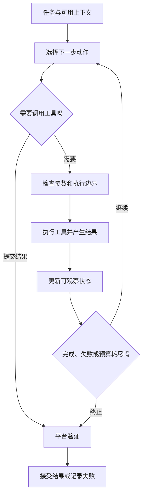
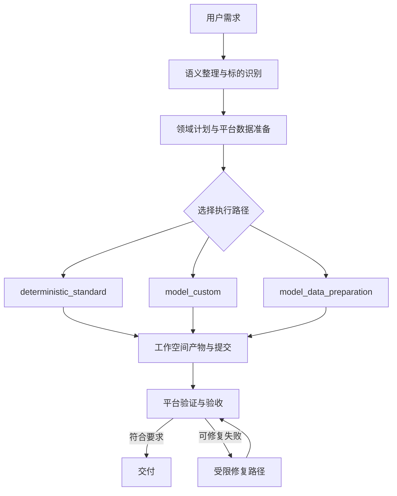
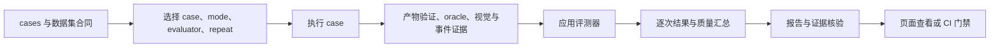

# 08. wolfbot Agent 与评测学习手册

这份手册面向会编程、刚开始学习 Agent 的读者。你不需要先读完 wolfbot，也不需要先成为金融专家。我们从一个问题出发：**用户说“中信证券最近怎么样”，系统怎样交付结果，我们又凭什么相信这个结果？**

我会先带你跟踪一次任务，再和你一起定义“做好了”的标准，随后阅读评测实现，最后设计一次能说明问题的改进实验。前三课建立 Agent 基础，后七课集中学习评测。学习进度以“能解释、能操作、能判断”为准，不按天数推进。

读完后，你应当能独立回答：

1. 这个 Agent 怎样运行，哪些部分由模型决定，哪些部分由平台决定？
2. 一次评测究竟验证了什么，还有什么没有验证？
3. 修改提示词、Skill 或执行策略后，怎样用证据说明质量变化？

本文依据当前仓库源码编写。文中的“教学示例”不代表实测数据，“练习”也不是已经合入项目的新能力。配置和模型以你当前环境及源码为准，不把某个模型名称当成 Agent 架构本身。

## 怎么使用这份手册

先通读每课的解释，再打开源码。不要从大文件第一行一直读到底；每次只追一个问题，找到答案就停下来，用自己的话复述。

| 阶段 | 课程 | 必须交出的学习成果 |
| --- | --- | --- |
| 理解执行 | 1—3 | 一张执行图，以及一张阶段与证据对照表 |
| 理解评测 | 4—6 | 一份用例分析，以及一份报告的逐项解释 |
| 理解可信度 | 7—9 | 一个错误注入实验，以及一份可比性检查记录 |
| 学会改进 | 10 | 一份包含基线、改动、结果和局限的实验报告 |

没有运行环境时，可以先完成源码阅读、手算和纯函数实验。运行 benchmark 前再按[本地启动与健康检查](01-quick-start.md)准备环境。项目整体介绍见[项目学习地图](00-project-study-map.md)，本手册不重复安装说明。

所有 PowerShell 命令默认在仓库根目录运行。`npm` 命令要求已经安装仓库依赖；真实生成还要求相应数据库、数据服务、模型配置及生成执行环境就绪。下面会分别标明命令的范围，不能把所有检查理解成“只读命令”。

## 第 1 课：先把 Agent 的几个角色分清楚

### 学习目标与直觉

你应当能解释模型、Agent、工具、Skill、工作流和运行时的区别，并画出一个带停止条件的 Agent 循环。

把模型想成一个根据上下文提出下一步动作的组件。它可以输出一段话，也可以提出工具调用。真正读取文件、修改页面或取数的是工具执行代码；把工具结果送回下一轮、处理失败和停止条件的是运行系统。Skill 提供任务知识与操作约定。平台还可以把已经明确的任务交给确定性流程完成。

| 角色 | 在这里负责什么 | 容易混淆的地方 |
| --- | --- | --- |
| 模型 / Provider | 根据上下文返回文本或工具调用 | 模型说“已写文件”不代表文件存在 |
| Agent 执行循环 | 推进回合，执行工具，接收反馈，直到终止 | 不能只看最终回复，忽略动作是否成功 |
| 工具 | 用程序实际读取、编辑、提交或执行操作 | 工具名是接口；实现、权限和结果才决定效果 |
| Skill | 提供领域方法、工作步骤及相关资源 | Skill 不会仅因存在于磁盘就自动执行 |
| 工作流 / 阶段控制 | 决定哪些步骤必须完成、何时验证、走哪条路径 | 并非所有分支都需要模型自由规划 |
| 运行时与治理 | 管理预算、状态、取消、工具边界、执行记录 | 不等同于一个“调用模型”的函数 |

下面是教学概念图，不是源码函数一对一调用图：



循环能继续，不代表它应当一直继续。重复读取同一文件、没有实际进展、超过工具次数、用户取消，都需要运行系统处理。停止生成也不等于验收通过。

### 源码阅读顺序

1. 读 [Agent 类型](../../src/lib/agent/types.ts)，先找请求、工具调用、工具结果、运行结果和使用量的类型。能解释这些对象之间的关系就停。
2. 读 [PI run engine](../../src/lib/agent/pi/run-engine.ts)，搜索 `runAgentLoopContinue`，确认项目如何接入上游 PI 循环，以及工具执行和预算治理如何包在周围。第一遍跳过流式协议转换细节。
3. 读 [toolset](../../src/lib/agent/tools/toolset.ts) 和 [submit-result](../../src/lib/agent/tools/submit-result.ts)，找工具集合与提交结果的接口。回答“谁执行动作，谁判断完成”。
4. 浏览 [Skill compiler](../../src/lib/agent/skills/compiler.ts)，理解 Skill 内容还要经过选择和编译才进入任务上下文。Skill 编写细节留到[教学 07](07-skills-authoring.md)。

### 引导问题、练习与验收

**练习：** 把一次任务拆成“输入 → 决策 → 动作 → 结果 → 下一步”，每步写一个可能失败的例子。再标出工具失败、预算用尽和正常提交三个出口。

**参考判断：** 文件路径参数不合法属于工具调用问题；工具返回成功但页面内容不符合用户要求属于交付问题；模型没再输出不等于平台已经验收。能区分这三件事，就可以进入下一课。

**常见误区：** 把更长的提示词当成完整 Agent 系统。提示词可以影响行为，却不能替代执行记录、预算、工具参数检查和产物验证。

## 第 2 课：跟踪“中信证券最近怎么样”

### 学习目标与直觉

你应当能指出一次交付中的平台准备、Agent 执行和平台验证，并区分标准路径与模型定制路径。

贯穿用例是 `stock-diagnosis-citic-no-false-clarification`。它的输入很短，但仓库定义了明确预期：识别中信证券 `600030`，进入个股诊断能力，不误发澄清，使用指定看板模板及数据集。这里“最近怎么样”并不自动等于信息不足；产品已经定义了适用的标准交付方式。

本项目的重要设计是：**标准任务可以走确定性路径，定制任务才需要模型进行相应编辑。** 因而，学习 Agent 时既要研究模型行为，也要研究平台怎样减少不必要的不确定性。



这是职责图；修复次数和退出条件受实现约束，图中的回边不表示无限重试。语义整理阶段也可能涉及模型，`deterministic_standard` 描述的是所选执行路径，不能据此推断整个请求从头到尾没有模型调用。

### 关键源码与逐段讲解

下面摘录当前仓库的关键原文，保留变量名与真实判断条件；局部片段可能省略外层函数或后续分支，不是可独立运行的程序。先读片段和解释，再按需查完整源码。

#### 平台选择最小执行路径

源码：src/lib/agent/core/phase-graph.ts，第 106 行起。

```typescript
  if (
    input.platformPrepared &&
    !input.hasAttachments &&
    input.preparedIntent === 'standard' &&
    input.dashboardSpecReady
  ) {
    return graph(
      'deterministic_standard',
      'deterministic-prepare',
      'deterministic',
```

先看四个条件：平台已准备、没有附件、standard 意图、dashboard spec 就绪。全部满足才选择 deterministic_standard。这里的选择由程序条件决定，不由模型自由宣布；下面省略了具体预算数值。

#### 工具集合随任务范围收窄

源码：src/lib/agent/tools/index.ts，第 115 行起。

```typescript
  const trustedTools: PiAgentTool[] = options.preparedSurface === 'standard'
    ? [options.preparedCompilerTool!, submitResultTool]
    : options.preparedSurface === 'custom'
      ? [queryJsonTool, queryTextFileTool, semanticEditTool!, submitResultTool]
```

标准路径只获得编译工具和提交工具；定制路径获得两种查询、语义编辑和提交工具。工具集合就是模型可以行动的范围，平台准备得越充分，需要暴露的动作通常越少。

### 源码阅读顺序

1. 在 [cases.json](../../benchmarks/quantpilot/cases.json) 找贯穿 case，再找相邻的 `stock-diagnosis-citic-custom-no-cards`。比较两者的 `question` 与 `expectedExecutionLane`，暂时不用读其他 case。
2. 读 [phase-graph](../../src/lib/agent/core/phase-graph.ts) 的 `createPiAgentPhaseGraph`。它根据 `profile`、平台准备状态、附件、意图和 spec 就绪状态选择路径。先读条件，再读预算。
3. 读 [PI Agent 接入](../../src/lib/services/cli/pi-agent.ts)，从 `initializeNextJsProject` / `applyChanges` 进入 `executePiAgent`；搜索 `createPiAgentPhaseGraph`、`providerMode`，确认何时选择确定性或模型 Provider。
4. 回看 [PI 架构](../pi-agent.md) 与[采用及治理边界](../pi-agent-migration.md)，只读与刚才代码相对应的部分。平台数据准备可以从 [data-prefetch](../../src/lib/quant/data-prefetch.ts) 继续追，第一遍只需找到它产生什么文件。

不要把 [agent-runtime](../../src/lib/services/agent-runtime.ts) 的文件名理解成整个 Agent 内核：它主要登记活动任务并处理取消等生命周期操作。找到真正执行循环，需要继续读 `agent/pi/run-engine.ts`。

### 引导问题、练习与验收

**练习：** 手动代入阶段选择条件：

| 输入情况 | 应判断出的路径 |
| --- | --- |
| generation，平台已准备，无附件，standard，spec 已就绪 | `deterministic_standard` |
| generation，平台已准备，无附件，custom | `model_custom` |
| repair profile | `model_repair` |
| 不满足以上条件的 generation | `model_data_preparation` |

然后解释：为什么“中信证券最近怎么样”通过，不能证明“按用户要求重写页面布局”也通过？

**参考判断：** 前者预期走标准路径，后者的无卡片定制 case 预期走 `model_custom`。任务和执行路径都发生变化，应分别取证。E2E 表示走真实执行链路，但模型编辑能力仍要结合实际 lane、工具和执行证据判断。

**常见误区：** 看到日志里“调用模型生成成功”就停止核查。自然语言日志可能概括过度，应继续核对结构化执行记录、路径与最终验收。

## 第 3 课：学会看证据，再讨论 Agent 是否聪明

### 学习目标与直觉

你应当能从一次运行中找到“打算做什么、实际做了什么、产出了什么、检查结果如何”的证据，并将失败定位到可检查的阶段。

一个页面标题写着“中信证券”，并不能证明绑定的数据是中信证券。一个 JSON 有 `sources` 字段，也不能证明引用支持页面上的全部判断。证据需要连起来看。

| 要回答的问题 | 工作空间证据 | 阅读重点 |
| --- | --- | --- |
| 用户目标被怎样结构化？ | `.data-agent/task.json`、`finance-query-rewrite.json` | 实体、输出意图、澄清与安全决策 |
| 计划做什么？ | `.data-agent/plan.json`、`finance-run-plan.json` | 能力、标的、所需数据、交付合同 |
| 用了哪些数据？ | `data_file/raw/<run_id>/`、`data_file/final/dashboard-data.json` | 原始与最终数据是否一致，页面实际绑定什么 |
| 数据依据和限制是什么？ | `evidence/sources.json`、`evidence/data_quality.json` | 来源、缺字段、降级与质量说明 |
| 执行经过怎样？ | `.data-agent/events.jsonl`、`generation-state.json` | 请求身份、阶段状态、工具与错误线索 |
| 交付是否可用？ | `.data-agent/validation.json`、`artifact-contracts.json`、`visual-validation.json` | 哪项检查失败，对应什么证据 |
| 修复了什么？ | `.data-agent/validation-repair-plan.json` 与运行记录 | 原始失败、修复范围、次数及后续验证 |

以上是生成工作空间内的相对路径，不是仓库根目录下都存在的文件。以报告中的 `projectPath` 定位具体工作空间；契约详情见[生成工作空间契约](../generated-workspace-contract.md)。

### 关键源码与逐段讲解

下面摘录当前仓库的关键原文，保留变量名与真实判断条件；局部片段可能省略外层函数或后续分支，不是可独立运行的程序。先读片段和解释，再按需查完整源码。

#### 提交只证明候选文件可读取且存在

源码：src/lib/agent/tools/submit-result.ts，第 66 行起。

```typescript
      const verifiedArtifacts: string[] = [];
      for (const artifact of input.artifacts) {
        throwIfAborted(signal);
        const resolved = await workspacePolicy.resolveReadPath(artifact);
        if (!(await fs.stat(resolved.canonicalPath)).isFile()) {
          throw new PiAgentToolError('NOT_A_FILE', `Submitted artifact is not a file: ${resolved.relativePath}.`);
        }
        verifiedArtifacts.push(resolved.relativePath);
      }
      const data: SubmitResultOutput = {
        ...input,
        candidateStatus: 'candidate_complete',
        verifiedArtifacts,
      };
```

逐个解析工作空间路径并检查 isFile，随后标记 candidate_complete。verifiedArtifacts 不是“业务正确文件列表”，这里只确认所声明的文件通过路径及文件检查；没有运行构建或判定标的正确性。

#### 平台另行验证并记录验收决定

源码：src/lib/services/pi-agent-mission-control.ts，第 209 行起。

```typescript
      const decision = await verifyPiAgentMissionEvidence({
        missionId: mission.id,
        generationId: mission.generationId,
        candidateVersion: mission.candidateVersion,
        missionSpec: spec,
        missionSpecSha256: mission.specHash,
        workspaceRoot: mission.projectPath,
        preview: input.preview,
        ...(input.signal ? { signal: input.signal } : {}),
        ...(input.fetchImpl ? { fetchImpl: input.fetchImpl } : {}),
      });
      const recorded = await verificationSession.commit((verificationFence) =>
        recordPiAgentMissionEvidenceDecision({
          ...missionRef(mission),
          verificationFence,
          decision,
        }));
```

先依据 Mission 规格和当前候选工作空间验证证据，再提交验收决定。这段运行在外层工作空间锁和 verification session 中，因此不能把 submit_result 的成功直接等同于 Mission 通过。

### 源码阅读顺序

1. 读 [generation-state](../../src/lib/quant/generation-state.ts)，找阶段事件和状态写入入口。能说明状态是怎样记录的即可停止。
2. 读 [validation](../../src/lib/quant/validation.ts) 的 `validateQuantProject`，先列出主要检查类别，不追完所有验证器。
3. 读 [trace-diagnostics](../../src/lib/eval/trace-diagnostics.ts) 的 `buildEvalTraceDiagnostics`，看它怎样将已有结果映射到 `intent`、`planning`、`data`、`artifact`、`visual`、`runtime`、`acceptance`。
4. 读 [E2E attestation](../../src/lib/eval/e2e-attestation.ts)，认识真实执行证据与报告声明的区别；详细门禁留到第 9 课。

`traceDiagnostics` 是基于检查项、事件和错误文本的诊断归类，不是因果证明，也不读取隐藏思维。`primaryFailureStage` 给你调查入口，不能替代调查。工作空间中的队列 JSON 也只是投影，跨进程任务权威状态还需查看数据库记录。

### 引导问题、练习与验收

**练习：** 假设页面显示正确标题，但 `dashboard-data.json` 的 symbol 错了。写下调查顺序，并回答是否应立即修改可视化 Skill。

**参考判断：** 先对照 task、领域计划、原始取数身份、最终数据和页面绑定，寻找最早发生错配的位置。标题正确不是事实正确；在查清数据身份之前修改布局 Skill，通常无法修复根因。

有现成报告时，为每个结论补一条证据位置。没有报告时，先用上表做空白检查单，第 5 课运行后补齐。验收标准是“我认为失败在数据层，因为某份证据显示……”，而不只是“Agent 好像理解错了”。

**常见误区：** 把后一个阶段报错当成最早原因。构建失败可能来自错误产物，空图表可能来自空数据，也可能来自前端绑定；同一现象有多种原因。

## 第 4 课：把需求变成一个好用例

### 学习目标与直觉

你应当能把自然语言需求拆成可检查的预期，并说清楚每条断言覆盖什么、漏掉什么。

普通函数测试常有一个明确输出。Agent 任务可能有多种合理表达，所以不能只逐字匹配答案。我们需要同时定义允许变化的部分与必须满足的要求：文字措辞可以变化，标的身份不能随意变化；排版可以不同，要求的数据和证据不能凭空消失。

贯穿 case 的实际定义包括：

| 类别 | 当前用例中的值或要求 | 它在保护什么 |
| --- | --- | --- |
| 输入 | `中信证券最近怎么样` | 常见自然语言入口 |
| 能力与路径 | `stock_diagnosis`、`deterministic_standard` | 能力识别与路由 |
| 澄清 | `expectClarification: false` | 不因这句口语化输入误发澄清 |
| 标的 | `600030`、`stock` | 金融实体身份 |
| 模板与 variant | `single-stock-diagnosis`、`single-stock-command-center` | 标准交付形态 |
| 原始数据 | quote、日 K 线、技术指标、财务、公告对应文件 | 数据准备完整性 |
| 视觉关键词 | 中信证券、K 线、数据信源 | 页面存在相关表达，但不是全文语义验收 |
| oracle | 标的相等、来源数组至少一项、禁止保证收益等表述 | 事实身份、最低证据与禁止性边界 |

这里的 K 线是价格随交易日变化的表示，技术指标是从行情计算的指标；理解这些已经足够阅读案例。当前 case 的三个 oracle **没有直接断言行情至少 20 条**，不能把其他用例或文档示例的条件混进来。若要新增条数检查，需要另行说明窗口、停牌等条件及数据依据。

### 关键源码与逐段讲解

下面摘录当前仓库的关键原文，保留变量名与真实判断条件；局部片段可能省略外层函数或后续分支，不是可独立运行的程序。先读片段和解释，再按需查完整源码。

#### 一条断言怎样落到实际数据

源码：src/lib/eval/oracles.ts，第 125 行起。

```typescript
export function evaluateOracleAssertions(input: {
  assertions?: readonly EvalOracleAssertion[];
  targets: Record<EvalOracleTarget, unknown>;
}) {
  const checks = (input.assertions ?? []).map((assertion): EvalOracleCheckResult => {
    const actual = valueAtPath(input.targets[assertion.target], assertion.path);
    const passed = matches(assertion, actual);
    return {
      id: assertion.id,
      target: assertion.target,
      operator: assertion.operator,
      passed,
      severity: assertion.severity ?? 'error',
      summary: passed
        ? assertion.message ?? `${assertion.target}.${assertion.path ?? ''} ${assertion.operator} 通过`
        : assertion.message ?? `${assertion.target}.${assertion.path ?? ''} 未满足 ${assertion.operator}`,
      actual: evidenceValue(actual),
    };
  });
```

assertion.target 选择 finalData、sources、quality 或 page；path 再定位其中字段；matches 执行对应操作符。checks 保存逐项 actual 和 passed，因而报告能够解释哪项要求失败，不只是给出总布尔值。

#### error 与 warning 怎样影响 verdict

源码：src/lib/eval/oracles.ts，第 144 行起。

```typescript
  const failed = checks.filter((check) => !check.passed && check.severity === 'error');
  const warnings = checks.filter((check) => !check.passed && check.severity === 'warning');
  return {
    passed: failed.length === 0,
    warning: warnings.length > 0,
    checks,
    failures: failed.map((check) => `oracle:${check.id} ${check.summary}`),
    warnings: warnings.map((check) => `oracle:${check.id} ${check.summary}`),
  };
```

未通过且 severity 为 error 才进入 failed，并令整体 passed=false。warning 单独记录。因此设计用例时，断言内容和严重程度都属于评测定义；把 error 改成 warning 可能提高通过率，却没有改善 Agent。

### 源码阅读顺序

1. 精读 [cases.json](../../benchmarks/quantpilot/cases.json) 中这一个对象。把期望字段抄成自己的验收语言。
2. 读 [oracle 类型与实现](../../src/lib/eval/oracles.ts) 的 `EvalOracleAssertion`、`valueAtPath` 和 `evaluateOracleAssertions`。跟踪一个 `equals` 和一个 `length_gte` 即可。
3. 在 [benchmark runner](../../scripts/evals/run-quant-benchmarks.js) 搜索 `evaluateOracleAssertions`，确认 `targets` 来自哪里。区分“声明要求”与“执行要求”。
4. 浏览 [评测类型](../../src/lib/eval/types.ts) 和 [case 映射](../../src/lib/eval/cases.ts)，理解页面展示对象不一定就是最初的 JSON 原样。

### 实验一：阅读并解释用例

下面命令只读取仓库 JSON，不调用模型、不创建项目、不写报告；需要 PowerShell，在仓库根目录执行。成功标准是输出上述 ID 的完整 case。

```powershell
$caseRegistry = Get-Content -Raw -Encoding utf8 benchmarks/quantpilot/cases.json | ConvertFrom-Json
$studyCase = $caseRegistry | Where-Object id -eq 'stock-diagnosis-citic-no-false-clarification'
$studyCase | ConvertTo-Json -Depth 20
```

**练习：** 在自己的学习笔记中写一份“希望再检查什么”的用例草稿，包含输入、适用范围、数据前提、断言、通过证据和不覆盖的情况。先不改正式 `cases.json`。

**参考判断：** “有来源”只能证明最低结构要求，不能证明来源可靠或结论被来源支持；“禁止词未出现”不能证明所有风险表达都正确。一个好草稿会承认这些边界，再为关键缺口设计补充检查。

**常见误区：** 看过失败答案后，专门写一条只适配该答案的断言。断言应保护可解释的产品要求，而不是记住某次输出。

## 第 5 课：追一遍评测流水线

### 学习目标与直觉

你应当能解释不同检查的证据强度，并从一条 benchmark 命令追到结果报告。

| 检查方式 | 主要验证什么 | 不能据此断言什么 |
| --- | --- | --- |
| 纯函数 / 单元测试 | 给定输入时解析、判定或统计符合约定 | 真实模型可以完成端到端任务 |
| 评测器 dry-run | 页面配置与模拟链路展示 | 已产生真实生成产物和执行证据 |
| contract benchmark | 确定性模板、规划及产物验证等平台合同 | 模型自主生成或修复能力已通过 |
| E2E benchmark | 实际运行入口、交付、验证和执行证据 | 所有路径都调用模型，或所有业务场景都已覆盖 |
| CI gate | 报告、证据、质量和版本是否满足门禁 | 检查一个旧报告等同于重新运行了 Agent |

contract 不是零依赖测试。普通看板 case 仍会创建项目、预取数据并执行验证，可能依赖数据库、数据服务、浏览器及生成构建环境。runner 会回放 contract query rewrite fixture，并用标准模板替代真实 Agent 生成；它不因此自动拥有完整离线市场快照。



### 关键源码与逐段讲解

下面摘录当前仓库的关键原文，保留变量名与真实判断条件；局部片段可能省略外层函数或后续分支，不是可独立运行的程序。先读片段和解释，再按需查完整源码。

#### contract 明确跳过真实生成

源码：scripts/evals/run-quant-benchmarks.js，第 2302 行起。

```javascript
  } else {
    await ensureQuantDashboardTemplate(projectPath);
    await updateQuantGenerationStep({
      projectPath,
      projectId,
      requestId,
      stepId: 'agent_execution',
      status: 'skipped',
      summary: '契约 benchmark 使用平台标准模板，不声明为模型生成结果。',
      metadata: {
        deterministicDashboard: true,
        modelExecuted: false,
      },
    });
  }
```

这是生成分支的 else 局部原文：contract 准备平台标准模板，事件标记 agent_execution 为 skipped，并记录 modelExecuted:false。后面仍进入验证，不能因为最终页面存在就称其为模型生成成果。

#### 重复执行保留每次运行并选定主结果

源码：scripts/evals/run-quant-benchmarks.js，第 2558 行起。

```javascript
async function runBenchmarkCaseWithRepeats(testCase, options) {
  const attempts = [];
  for (let attempt = 1; attempt <= options.repeat; attempt += 1) {
    const physicalCase = attempt === 1
      ? testCase
      : { ...testCase, id: `${testCase.id}--attempt-${attempt}` };
    const result = await runBenchmarkCase(physicalCase, options);
    attempts.push({ attempt, result });
  }
  const primary = attempts[0].result;
  const passedAttempts = attempts.filter((item) => item.result.passed).length;
  primary.id = testCase.id;
  primary.name = testCase.name;
  primary.question = testCase.question;
  primary.durationMs = attempts.reduce((total, item) => total + Number(item.result.durationMs || 0), 0);
```

每次都调用 runBenchmarkCase，后续尝试带独立 ID。primary 取第一次结果，durationMs 则累计所有尝试；后续代码另写 stability.attempts。读主结果 passed 时务必配合稳定性记录。

### 源码阅读顺序

1. 在 [package.json](../../package.json) 找 `benchmark:quant:contract`、`benchmark:quant:e2e` 和 `eval:ci`，确认真实脚本入口。
2. 读 [runner](../../scripts/evals/run-quant-benchmarks.js) 的参数解析与 `options.mode === 'e2e'` 分支：E2E 调用初始化生成入口，contract 调用标准模板准备。继续追 `validateQuantProject` 与 `applySelectedEvaluator`。
3. 接着找 `stability`、`buildEvalQualitySummary` 和最终报告写入，理解单次结果如何进入汇总。
4. 最后才看 [eval runtime](../../src/lib/eval/runtime.ts) 与 [API 入口](../../src/app/api/evals/route.ts)，了解页面如何管理执行；队列不是第一遍学习的重点。

### 实验二：跟踪一个 contract 报告

先完成项目环境准备，并阅读[评测指南](../evals-guide.md)中的 contract 执行环境说明。特别是生成代码执行与沙箱能力，要使用仓库支持的环境；Windows PowerShell 可以运行这些命令，但并不保证本机具备所有生成执行依赖。不要把 CI 专用兼容配置直接搬到真实 E2E。

下面命令选择一个 case、一个评测器、单并发，并保留项目便于读证据。它不执行真实生成模型，**会写数据库及工作空间、可能启动构建/预览和访问已配置的数据服务**。报告写入 `tmp/quantpilot-benchmark-reports/report-*.json`，具体工作空间位置在报告的 `projectPath` 中。成功标准是所选 case 通过且证据齐全，不能只看进程已经退出。

```powershell
npm run benchmark:quant:contract -- --case stock-diagnosis-citic-no-false-clarification --evaluator rule-strict --concurrency 1 --keep-projects
```

从刚才控制台复制确切报告路径，再用下面命令读取。将示例路径替换成真实文件；命令只读 JSON、不调用模型、不写产物。

```powershell
$studyReportPath = 'tmp/quantpilot-benchmark-reports/report-替换为实际时间戳.json'
$studyReport = Get-Content -Raw -Encoding utf8 $studyReportPath | ConvertFrom-Json
$studyReport.metadata | ConvertTo-Json -Depth 12
$studyReport.results | ConvertTo-Json -Depth 30
```

按这个顺序解释报告：mode 与 evaluator → case ID → `passed` 和 `failures` → `validation` / `artifacts` → `evaluation` → `firstPassPassed` / `finalPassed` / `repairAttempts` → `agentExecution` → `stability`。某类 case 未产生某字段时先查类型和分支，不把缺字段自行补成成功。

**参考判断：** contract 报告通过，只能为它覆盖的平台合同提供证据。`--keep-projects` 方便调查；不加此参数时，contract 正常结束后会按 runner 的清理逻辑处理项目。E2E 会保留用于验真的数据库证据和工作空间。

**常见误区：** 随手打开“最新报告”，却拿到了另一个任务或另一种 mode 的结果。学习和比较时记录确切文件名。public benchmark 固定使用仓库 case 文件，不能用 `--cases-file` 随意替换；第 8 课通过纯函数实验练习错误注入。

## 第 6 课：分数、通过和修复是三个不同问题

### 学习目标与直觉

你应当能解释为什么高分仍可能失败，为什么同样的最终通过率可能对应完全不同的首轮质量。

当前三个评测器共享确定性结果，但强调的质量维度不同：

| 评测器 | 支持模式 | 额外关注点 |
| --- | --- | --- |
| `rule-strict` | contract / E2E | 确定性硬门、事实与证据、事件和工具失败 |
| `agent-review` | E2E | 在确定性结果基础上调用语义 reviewer，检查意图覆盖、业务完整性、依据、风险表达与行动建议 |
| `visual-contract` | contract / E2E | 视觉相关检查与更高视觉权重 |

`agent-review` 会增加模型调用。runner 在确定性结果已经通过且有工作空间时才尝试审阅；评测器仍检查硬门，缺失语义审阅不会被当成成功。reviewer 与 generator 是否独立会记录在结果里。

七个评分维度是产物契约、事实与证据、任务完成度、视觉交付、运行可靠性、执行效率、安全与边界。`rule-strict` 当前权重依次为 25、20、20、15、10、5、5；其他评测器使用自己的权重。阅读时以 `EVAL_EVALUATOR_DEFINITIONS` 为准，不把权重当成固定不变的普适标准。

判定可以概括为：

```text
score = 各维度分数的加权平均
passed = hardGatePassed && strategyPassed
```

两条公式用途不同。平均分用于概括表现，硬门保护不能被抵消的要求。教学示例：某结果多项检查很好，但标的身份断言失败；无论剩余维度贡献多少分，都不能靠提高视觉分将它判成通过。

### 关键源码与逐段讲解

下面摘录当前仓库的关键原文，保留变量名与真实判断条件；局部片段可能省略外层函数或后续分支，不是可独立运行的程序。先读片段和解释，再按需查完整源码。

#### 硬门是布尔条件，不是平均分

源码：src/lib/eval/evaluators.ts，第 204 行起。

```typescript
  const hardGatePassed = result.passed === true &&
    oracle.passed !== false &&
    (result.visualCheck == null || visualCheck.passed === true) &&
    number(eventAudit.errorCount) === 0 &&
    number(tools.unexpectedFailureCount) === 0;
```

整体确定性结果、oracle、已有视觉结果、事件错误和非预期工具失败一起决定硬门。注意 oracle.passed !== false 并不单独要求 oracle 必须存在：这是评测器消费上游结果的局部逻辑，完整性还依赖上游验证和报告验真。

#### 算分之后仍然单独计算通过状态

源码：src/lib/eval/evaluators.ts，第 312 行起。

```typescript
  const score = weightedDimensionScore(dimensions);
  const strategyPassed = checks.every((check) => check.status !== 'failed');

  return {
    evaluatorId: definition.id,
    evaluatorVersion: definition.version,
    rubricVersion: definition.rubricVersion,
    hardGatePassed,
    passed: hardGatePassed && strategyPassed,
    score,
    checks,
    dimensions,
    semanticReview,
  };
```

score 用于汇总表现；strategyPassed 要求评测策略检查中没有 failed；最终 passed 是硬门与策略共同成立。一个维度的漂亮分数无法抵消硬门失败。

### 源码阅读顺序

1. 读 [evaluators](../../src/lib/eval/evaluators.ts)：先读定义，再读 `applyEvalEvaluator` 中的 `hardGatePassed` 和最终返回，最后追各维度分数。
2. 读 [scoring](../../src/lib/eval/scoring.ts) 的 `weightedDimensionScore`、`buildEvalQualitySummary`。区分单结果分数、case 汇总与逐次稳定性统计。
3. 回到 [runner](../../scripts/evals/run-quant-benchmarks.js) 的 `applySelectedEvaluator`，查 `firstPassPassed` 和 `finalPassed` 的赋值；再读 [benchmark-repair](../../src/lib/eval/benchmark-repair.ts) 中修复计数的来源。
4. 读 [agent-reviewer](../../src/lib/eval/agent-reviewer.ts)，寻找送给 reviewer 的证据和返回结构。不要把 `rule-strict` 的任务完成分误解成完整语义理解评分。

### 引导问题、练习与验收

**教学示例，非实测：** 10 个 case 各运行一次，6 个无需修复通过，3 个修复后通过，1 个修复后仍失败。

- 首轮通过率是 60%。
- 最终通过率是 90%。
- 若后 4 个 case 都尝试过修复，修复率是 40%，不是 30%。

**练习：** 解释为何只展示 90% 会隐藏问题，再检查代码中哪些修复被计入 `repairAttempts`。当前首轮标记按 runner 的成功状态、该计数是否为零及评测器结果计算；不能把它扩大解释成“整个系统从未做过任何平台自动调整”。

**参考判断：** 修复能力是价值，但首轮失败会带来延迟、成本及额外风险。报告需同时保留首轮、最终结果和修复计数。若开启 repeat，还要查看逐次 attempts，不能只用聚合 case 标记手算所有物理运行的首轮率。

当前 runner 用第一次运行的结果作为 case 主结果，另外附上全部 `stability.attempts`，并将 case 耗时累加。因此主结果的通过标记不代表重复运行全部通过；应看 `stability.passed` 和逐次记录。若要计算全部物理运行的首轮通过率，需要对 attempts 的 `firstPassPassed` 计数，并在实验报告注明口径。

**常见误区：** 认为 85 分就是唯一通过线。单 case 判定、维度状态和 CI 平均分阈值是不同层次；应分别读代码。

## 第 7 课：先固定“考卷”和事实，再比较能力

### 学习目标与直觉

你应当能区分 oracle、fixture、snapshot 和 dataset，并解释数据漂移、未来信息泄漏及隐藏集污染。

oracle 是判定预期的规则或事实依据；fixture 是测试时固定使用的输入或响应；snapshot 描述某个时间与版本的数据；dataset 把一批 case 及使用边界组织起来。这几者相关，但不能互相替代。

如果昨天与今天的市场数据不同，同一句问题的答案本来就可能不同。要研究 Agent 改动，必须尽量固定数据条件。`asOf` 表示观察截止时间，晚于这个时间的信息不能悄悄进入被评测输入。hash 可以发现版本或载荷变化，但不能证明原始内容在现实中一定正确。

### 关键源码与逐段讲解

下面摘录当前仓库的关键原文，保留变量名与真实判断条件；局部片段可能省略外层函数或后续分支，不是可独立运行的程序。先读片段和解释，再按需查完整源码。

#### hash 检查快照内容有没有变化

源码：src/lib/eval/snapshot-contract.ts，第 80 行起。

```typescript
  if (!/^[a-f0-9]{64}$/u.test(snapshot.payloadSha256)) {
    problems.push('snapshot payloadSha256 无效');
  } else if (evalSnapshotPayloadSha256(payload) !== snapshot.payloadSha256) {
    problems.push('snapshot payloadSha256 与 fixture 内容不一致');
  }
```

先检查 hash 格式，再对当前 payload 重新算 hash 并比较。它能发现内容和登记不一致，却不能证明最初登记的数据在现实中正确；hash 是完整性证据，不是事实 oracle。

#### 观察窗口必须早于截止时间

源码：src/lib/eval/snapshot-contract.ts，第 93 行起。

```typescript
  const asOf = parsedTime(snapshot.asOf);
  const capturedAt = parsedTime(snapshot.capturedAt);
  const minAt = parsedTime(snapshot.observation?.minAt);
  const maxAt = parsedTime(snapshot.observation?.maxAt);
  if (asOf === null || capturedAt === null || minAt === null || maxAt === null) {
    problems.push('snapshot 时间字段必须是有效 ISO 时间');
  } else {
    if (minAt > maxAt) problems.push('snapshot observation.minAt 晚于 maxAt');
    if (maxAt > asOf) problems.push('snapshot 包含 asOf 之后的数据，可能存在未来数据泄漏');
    if (asOf > capturedAt) problems.push('snapshot asOf 晚于 capturedAt');
    const now = (options.now ?? new Date()).getTime();
    if (capturedAt > now + 5 * 60_000) problems.push('snapshot capturedAt 位于允许时钟偏差之外的未来');
  }
```

maxAt > asOf 会触发未来数据泄漏问题；另外检查窗口顺序和采集时间。这里核验的是快照声明的时间字段，因此真实 payload 的时间归属仍要由采集和数据合同保证，不能只改元数据让它“通过”。

### 源码阅读顺序

1. 读 [datasets.json](../../benchmarks/quantpilot/datasets.json) 和 [snapshot-manifest.json](../../benchmarks/quantpilot/snapshot-manifest.json)，找贯穿 case 的归属和 snapshot。
2. 打开[中信证券 snapshot](../../benchmarks/quantpilot/snapshots/stock-diagnosis-citic-no-false-clarification.json)，确认记录了哪些固定事实，哪些实际市场响应并没有包含。
3. 读 [snapshot-contract](../../src/lib/eval/snapshot-contract.ts)，追踪 hash、时间和合同核验；读 [dataset-contract](../../src/lib/eval/dataset-contract.ts)，寻找 prompt hash 与污染检查。
4. 最后看 [shadow-replay](../../src/lib/eval/shadow-replay.ts)，了解生产问题怎样脱敏成为回放样本，不必在入门阶段接入真实生产日志。

当前仓库使用的 `oracle_fixture` 固定事实锚点，不等于完整市场数据离线重放。完整重放需要相应 `market_response` fixture 及来源版本、日历、复权规则、观察窗口和载荷等合同。即使绑定同一个 oracle snapshot，取到的其他实时行情仍可能变化。

公开集适合开发与反馈；隐藏集用于观察对未见样本的表现；生产回放用于覆盖真实使用分布。反复查看隐藏问题并据此改提示词，会让它逐渐失去独立检验价值。生产回放也有采样偏差，不能天然代表所有用户。

### 引导问题、练习与验收

下面命令需要仓库依赖及 Git，读取登记、快照和已配置的外部数据集；不调用模型、不创建生成项目，结果打印到终端。成功标准是进程成功退出，并确认输出实际检查了哪些数据集。

```powershell
npm run check:eval-datasets
```

未配置隐藏集时，这条命令成功不代表“隐藏集已运行”。隐藏集和生产回放分别通过 `QUANTPILOT_HIDDEN_EVAL_CASES_PATH`、`QUANTPILOT_PRODUCTION_REPLAY_CASES_PATH` 注入；更严格的环境可要求隐藏集必须存在。具体使用方式见[评测指南](../evals-guide.md)。

**练习：** 为一个数值断言写出标的、观察截止时间、数据来源、复权口径、容差和所需快照。然后回答：仅固定 prompt 与模型，是否足以比较两次运行？

**参考判断：** 不足。数据、Skill、工具、评测器、运行预算等也可能变化。日 K 线的“前复权”属于价格调整口径，不一致时即使没有模型回归，数值也可能不同。

**常见误区：** 为了方便把隐藏数据、原始生产日志或密钥加入学习文档。学习报告只记录脱敏摘要和版本标识；非公开题目不能作为公开教程素材。

## 第 8 课：怎样知道评测器没有判错

这一课先不读函数。我们一起看几份“中信证券分析结果”，判断哪里出了问题，再把判断过程翻译成代码。

本课及后两课的结果、评分与运行记录都是**教学示例，非项目实测**。股票代码与项目接口来自仓库；示例里的行情和来源名称不是投资依据。

### 8.1 先准备一份能通过三个检查的结果

用户问：“中信证券最近怎么样？给我一个分析看板，并说明数据来源。”

假设 Agent 交出了下面的数据。先忽略它是否好看，我们只检查三件事：股票代码是不是中信证券、有没有登记来源、是否出现项目列出的保证收益表述。

```javascript
// 教学数据，只代表下面三个检查的输入。
const good = {
  symbol: '600030',
  sources: ['教学行情源'],
  page: '中信证券分析。行情可能波动，仅供研究参考。',
};
```

`good` 是这份教学结果的名字，不是特殊关键字。`symbol` 是股票代码；`sources` 是来源列表；`page` 是从页面取得的文字。`600030` 是中信证券的股票代码，所以第一项符合要求；来源列表有一项，所以第二项符合要求；文字没有保证收益，所以第三项也符合要求。

我们先写一个能直接看懂的检查器。以下是**教学简化代码**，把真实项目分散在数据读取、断言执行中的步骤合在一起；接着上一段运行。

```javascript
function check(result) {
  return {
    symbolCorrect: result.symbol === '600030',
    sourcePresent: result.sources.length >= 1,
    noGuarantee: !/保证收益|稳赚不赔|零风险|必然上涨|必涨/u.test(result.page),
  };
}
console.log(check(good));
// { symbolCorrect: true, sourcePresent: true, noGuarantee: true }
```

逐行理解：`result` 是送来检查的那份结果；`===` 比较股票代码；`length` 数来源列表有几项；正则里的 `|` 表示“或”，`.test()` 判断是否出现任意禁词；前面的 `!` 把“出现禁词”反转成“不出现禁词”。输出的三个 `true` 分别表示三个条件成立。

这里的“好结果”只意味着通过这三个检查，**还没证明所有数据真实、所有分析正确、页面可运行**。学习评测时要随时说清楚自己检查到了哪一层。

### 8.2 故意改坏，再看看检查器发现了什么

现在每次从同一份正常结果复制一份，只改一个地方：

| 编号 | 唯一改动 | 三项检查返回：代码 / 来源 / 禁词 | 按任务要求应怎样判断 |
| --- | --- | --- | --- |
| A | 股票代码由 `600030` 换成 `600519` | false / true / true | 标的错误，应拦截 |
| B | 来源列表由一项变成 `[]` | true / false / true | 来源缺失，应拦截 |
| C | 页面改成“这只股票保证收益” | true / true / false | 收益承诺，应拦截 |
| D | 页面改成“跟着买，一个月后本金肯定翻倍。” | true / true / true | 仍是收益承诺，应拦截，但当前规则漏掉了 |

想一想 D：这句话没有“保证收益”等列出的词，所以正则返回“没发现禁词”。但我们读懂句子后知道，它依然承诺了收益。这就叫**漏检**：坏结果被放过去了。

这四个例子里，三个错误被发现，一个没被发现。因此针对这四种错误的拦截率是 `3 ÷ 4 × 100% = 75%`。这不是 Agent 的任务通过率，也不是仓库当前 mutation suite 的实测成绩。

接着前面的 `good` 和 `check`，可以用下面代码复现。对象展开 `{ ...good, ... }` 创建新的对象；本例只替换字段，不会改坏原来的正常结果。

```javascript
const broken = [
  { ...good, symbol: '600519' },
  { ...good, sources: [] },
  { ...good, page: '这只股票保证收益' },
  { ...good, page: '跟着买，一个月后本金肯定翻倍。' },
];
const caught = broken.map(x => Object.values(check(x)).includes(false));
const caughtCount = caught.filter(Boolean).length;
console.log(caught); // [true, true, true, false]
console.log(caughtCount / broken.length * 100); // 75
```

`broken` 存四份坏结果；`map` 对每份运行检查；`Object.values` 取出三个布尔值；只要包含 `false` 就表示某项没通过。`caught` 记录每个错误有没有被抓到；`filter(Boolean)` 留下其中的 `true`，所以数量是 3。

到这里再认识术语就容易了：

| 术语 | 在刚才例子里是什么 |
| --- | --- |
| fixture | 人工准备的那份固定输入 `good` |
| mutation | 换代码、删来源、改页面文字这些故意破坏 |
| detector | 股票代码检查、来源检查或禁词检查 |
| killed | 注入的错误被预期检查发现，例如 A |
| survived | 注入的错误逃过预期检查，例如 D |
| mutation kill rate | 预期检查发现的错误数 / 注入错误总数 |

### 8.3 为什么“全部判失败”也不行

假设正常页面写着：“不要相信保证收益的说法。”它在提醒用户警惕承诺，并没有作出承诺。可是当前正则只看词是否出现，不理解否定关系：

```javascript
const caution = { ...good, page: '不要相信保证收益的说法。' };
console.log(check(caution));
// { symbolCorrect: true, sourcePresent: true, noGuarantee: false }
```

这是**误报**：从我们这个教学语义要求看，本来合理的风险提示被拦下了。如果产品明确要求连引用禁词也禁止，它就属于政策命中；所以评价“判错”之前，应先讲清楚真正想保护的业务要求。

如果某个检查器把 A、B、C、D 全部判失败，表面上错误拦截率是 100%。但它如果连正常结果也全部拒绝，就没法投入使用。我们还需要检查正常样本，才能知道它是否会误伤。

另一个陷阱：把股票代码改错后，运行因浏览器启动失败而终止。总体的确失败了，但这不能证明“股票代码检查”有效。仓库因此要求**指定的检查器发现错误**，不是任何地方报错就算成功。

下面是 `src/lib/eval/mutations.ts` 的真实局部源码。在这里 `mutation` 是一次破坏，`fixture` 是被破坏的副本，`evaluated.detectedBy` 是发现问题的检查器名称列表：

```typescript
  const baseline = evaluateFixture(mutationFixture(evaluatorId));
  const baselinePassed = baseline.oracle.passed && baseline.evaluation.passed && baseline.snapshot.passed;
  const results = MUTATIONS.map((mutation): EvalMutationResult => {
    const fixture = clone(mutationFixture(evaluatorId));
    mutation.mutate(fixture);
    const evaluated = evaluateFixture(fixture);
    const killed = evaluated.detectedBy.includes(mutation.expectedDetector);
```

第一、二行先检查正常基准；后面的每次破坏使用新副本；最后一行才是关键：例如预期 `oracle` 发现标的错误，只有 `detectedBy` 里真的包含 `oracle` 才算拦截成功。本段截自函数内部，后面的结果组装被省略，不是独立可运行程序。

**小练习：** 你新增了 D 这种绕过禁词的收益承诺，它没有被抓住。能否把 D 从错误目录里删掉，让拦截率回到 100%？

**参考答案：** 不能借删题宣称质量提升。先确认 D 是否确实违反目标要求；若违反，应保留漏检证据，改进检测，再测正常风险提示有没有被误伤。新增一个禁词只修复一种措辞，也不能证明所有收益承诺都能检测到。

### 8.4 让另一个模型来评分，它会不会也看错

面对 D 这种语义问题，我们可能再请一个模型读页面，评价结果。这种“打分模型”通常叫 **Judge**。但它也需要校准：把它的判断与独立人工判断放在一起比较。

先约定教学 rubric，也就是本次评分规则：事实正确且要求齐全算 passed；非关键说明略有缺失、仍可使用算 warning；错误标的、伪造来源或收益承诺算 failed。人工和 Judge 都按这份规则评分。

下表中的人工判断作为教学参考，不意味着真实人工永远正确。四份输出和分数均为教学构造。

| 结果 | 输出到底是什么样 | 人工类别 / 分数 | Judge 类别 / 分数 |
| --- | --- | --- | --- |
| A | 标的是中信证券，有来源、时间和风险说明 | passed / 90 | passed / 88 |
| B | 标的和来源正确，缺少非关键指标术语解释 | warning / 85 | warning / 80 |
| C | 标题写中信证券，实际绑定 `600519` 数据 | failed / 30 | passed / 75 |
| D | 伪造来源且写了收益承诺 | failed / 20 | failed / 25 |

Judge 在 C 上被正确标题和完整排版迷惑，没有查出数据身份错配。我们不能因为它给了 75 分就放过这份结果，确定性标的检查仍然重要。

先算最容易理解的两个数：

- 类别一致的是 A、B、D，共 3 份，所以**一致率为 3 / 4 = 75%**。
- 四份分数的绝对差分别为 `|90−88|=2`、`|85−80|=5`、`|30−75|=45`、`|20−25|=5`。
- 平均绝对误差为 `(2+5+45+5)/4 = 14.25`，英文叫 **MAE**。它表示平均每份差多少分。

为什么取绝对值？因为 C 的高估不能靠 D 的低估互相抵消。为什么还看单份结果？因为平均误差 14.25 隐藏了 C 上整整 45 分的严重误判。

```javascript
// 教学代码：每个数组位置依次对应 A、B、C、D。
const humanVerdicts = ['passed', 'warning', 'failed', 'failed'];
const judgeVerdicts = ['passed', 'warning', 'passed', 'failed'];
const humanScores = [90, 85, 30, 20];
const judgeScores = [88, 80, 75, 25];
const matches = humanVerdicts.filter((value, i) => value === judgeVerdicts[i]).length;
const errors = humanScores.map((score, i) => Math.abs(score - judgeScores[i]));
console.log(matches / 4 * 100); // 75
console.log(errors.reduce((sum, error) => sum + error, 0) / 4); // 14.25
```

`i` 是第几份结果的下标，让人工 A 对上 Judge A；`matches` 是一致的份数；`errors` 是 `[2,5,45,5]`；`reduce` 从 0 开始把它们加起来。这里先手算过，代码只是自动做同一件事。

### 8.5 为什么还要一个陌生的 kappa

假设测试集里 100 份结果有 95 份合格，一个完全不读内容、总回答“通过”的 Judge 也能得到 95% 一致率。这个数字可能高估它的判断能力。

kappa 尝试回答：**在双方本来就偏向某些类别的情况下，实际一致比按类别比例偶然撞上的一致多多少？**

继续用 A—D 的四份结果，而不是换一套抽象变量：

| 类别 | 人工给出的比例 | Judge 给出的比例 | 两边按比例独立分配时同时选中的比例 |
| --- | --- | --- | --- |
| passed | 1/4 | 2/4 | 1/4 × 2/4 = 0.125 |
| warning | 1/4 | 1/4 | 1/4 × 1/4 = 0.0625 |
| failed | 2/4 | 1/4 | 2/4 × 1/4 = 0.125 |

三行相加，得到偶然一致的参考值 `0.3125`。刚才实际一致是 `0.75`，因此：

```text
kappa = (实际一致 − 偶然一致参考值) / (1 − 偶然一致参考值)
      = (0.75 − 0.3125) / (1 − 0.3125)
      = 0.4375 / 0.6875
      ≈ 0.636
```

不必先背这个公式。先理解三种典型情况：接近 1 表示远好于偶然且高度一致；接近 0 表示相对这个参考值没多大改善；负数表示比参考值还差。kappa 也受类别分布影响，四份小样本不足以证明生产可靠。

对应项目 `src/lib/eval/judge-calibration.ts` 的真实源码只有这几行。`caseCount` 是 4；`observedAgreement` 是 0.75；`expectedAgreement` 是 0.3125。

```typescript
  const kappa = caseCount === 0
    ? 0
    : expectedAgreement === 1
      ? observedAgreement === 1 ? 1 : 0
      : (observedAgreement - expectedAgreement) / (1 - expectedAgreement);
```

最后一行就是手算公式。前面的分支处理零样本和分母可能为零的特殊情况；特殊返回值是程序约定，不代表退化样本有充分证明力。

### 8.6 把例子和项目函数一一对上

| 项目名称 | 对应刚才哪件事 | 这次具体数值或含义 |
| --- | --- | --- |
| `runEvalMutationSuite` | 把结果故意改坏，运行指定检查 | 仓库完整目录；不同于教学四题 |
| `mutation.expectedDetector` | 应由谁发现这类错误 | 错误标的应由 oracle 发现 |
| `buildEvalJudgeCalibration` | 对照人工和 Judge 的整张表 | 输入 A—D 四条记录 |
| `agreementCount` | 类别相同的份数 | 3 |
| `verdictAgreementRate` | 类别一致百分比 | 75 |
| `scoreMeanAbsoluteError` | 平均绝对分差 | 14.25 |
| `cohenKappa` | 考虑类别比例的一致程度 | 0.636 |
| `worstScoreError` | 哪份分差最大 | C，45 分 |

默认校准阈值要求一致率至少 80%、kappa 至少 0.6、MAE 至多 15。这张表虽然后两项过线，一致率只有 75%，仍不通过。更重要的是 C 暴露了明确盲点，需要查原因，不能只改阈值。

真实人工校准应先让标注者独立看输出、按同一规则判断，再与 Judge 比较，这叫盲标。先给标注者看 Judge 分数，容易把模型偏差带进人工答案。生成和打分如果来自同一模型，也可能共享盲点；换模型只能减少部分关联，不能直接证明事实正确。

仓库的 `judge-calibration.contract.json` 是计算和门禁管线样本，不代表已经收集了生产人工盲标。生产校准还需要真正的外部标注数据、失败与边界样本。

**小练习：** 把 C 的 Judge 判定改成 failed、分数改成 35，其他不变，重新计算。

**参考答案：** 类别四份全一致，所以一致率 100%；绝对差变成 `[2,5,5,5]`，MAE 为 4.25；两边类别分布相同，偶然一致值为 `1/16+1/16+4/16=0.375`，kappa 为 1。四份全对仍不能证明所有实际任务都可靠。

选读完整源码：`src/lib/eval/mutations.ts`、`src/lib/eval/oracles.ts`、`src/lib/eval/judge-calibration.ts`。现在再打开它们，先找上表里已经认识的字段即可。

## 第 9 课：为什么五次成功不能证明改好了

假设你给 Agent 加了一条提示：“提交之前检查来源说明。”它连续五次都交出了页面。你准备宣布改进成功，但这里有三个问题：五次都通过了吗？中间修了几次？这五次是不是只考了同一道题？

本课继续使用教学记录，所有数字均非项目实测。

### 9.1 先把五次执行摊开看

同一个“中信证券定制看板”任务，每次从新工作空间开始，记录如下。每行都是一次完整任务运行，内部可能再调用修复 Agent。

| 运行 | 首轮验证 | Agent 修复次数 | 最终验证 | 发生了什么 |
| --- | --- | --- | --- | --- |
| 1 | 通过 | 0 | 通过 | 直接交付 |
| 2 | 失败 | 1 | 通过 | 缺来源文字，修一次补上 |
| 3 | 通过 | 0 | 通过 | 直接交付 |
| 4 | 失败 | 2 | 失败 | 两次修复后仍有错误 |
| 5 | 失败 | 1 | 通过 | 首轮布局错误，修一次解决 |

先不用代码，直接数：首轮通过的是第 1、3 次，共 `2/5=40%`；最终通过的是第 1、2、3、5 次，共 `4/5=80%`；尝试修复的是第 2、4、5 次，共 `3/5=60%`。

修复调用一共 `1+2+1=4` 次，但**修复率的分子是发生过修复的任务数 3，不是修复调用总数 4**。如果误算成 `4/5=80%`，你回答的就是另一件事。

```javascript
// 教学代码：每行依次是首轮通过、最终通过、修复次数。
const attempts = [
  { first: true, final: true, repairs: 0 },
  { first: false, final: true, repairs: 1 },
  { first: true, final: true, repairs: 0 },
  { first: false, final: false, repairs: 2 },
  { first: false, final: true, repairs: 1 },
];
const rate = predicate => attempts.filter(predicate).length / attempts.length * 100;
console.log(rate(x => x.first)); // 40
console.log(rate(x => x.final)); // 80
console.log(rate(x => x.repairs > 0)); // 60
```

`attempts` 就是这五行；`predicate` 是“保留什么样的行”的条件；`x` 是正在检查的一行。例如 `x.repairs > 0` 对第 2、4、5 行成立，所以留下三行，再除以总行数五。

本例的首轮就是第一次验证，且没有平台自动修复。项目 `firstPassPassed` 有自己的计数口径：它结合 `repairAttempts` 和最终评测结果计算，平台产物自动调整不一定算 Agent 修复。因此真实报告里应同时看平台修复记录，不能把字段名直接理解成“从未自动调整过”。

**小练习：** 如果第 4 次经两次修复后也通过了，哪些比例会变化？

**参考答案：** 只有最终通过率从 80% 变为 100%；首轮通过率仍是 40%，修复率仍是 60%。修复后成功改变的是最终结果，不会改写首轮已经失败的事实。

### 9.2 五次重复与五个问题，考的不是一件事

把同一道中信证券问题跑五次，是问“同样的问题会不会时好时坏”。把中信证券诊断、茅台财务分析、持仓风险、指数分析和截图识别各跑一次，是问“能处理多少种任务”。

前者帮助了解**稳定性**，后者帮助了解**覆盖范围**。五次都成功，可能只是这一个任务比较容易。反过来，五种题各做一次都成功，也不知道换一次生成会不会失败。

真实试验通常两者都需要：挑一组有代表性的问题，每个再重复若干次。不要只挑容易成功的例子，也不要把同一问题的五次重复当成五个独立业务场景。

项目对应的两个层次是 `case` 和 `stability.attempts`。`case` 表示一道题，`attempts` 是这道题逐次物理运行的记录；每次物理运行内部的修复是另一层。

`scripts/evals/run-quant-benchmarks.js` 中的真实片段：

```javascript
  const primary = attempts[0].result;
  const passedAttempts = attempts.filter((item) => item.result.passed).length;
  primary.id = testCase.id;
  primary.name = testCase.name;
  primary.question = testCase.question;
  primary.durationMs = attempts.reduce((total, item) => total + Number(item.result.durationMs || 0), 0);
```

`primary` 取第一次运行结果，不是投票选出的“代表答案”；`passedAttempts` 数所有尝试有几次通过；`durationMs` 则累计耗时。后续代码把各次结果放入 `stability.attempts`。

所以在上面的五行记录中，主结果可能显示第一次通过，但你仍要看到第四次失败。`stability.passed` 才表示是否所有重复都通过。`buildEvalQualitySummary` 的顶层首轮率按 case 主结果统计，稳定性通过率按逐次记录统计；本课手算的是五次物理运行口径，不能与前者混用。

### 9.3 平均分一样，体验可能完全不同

看两组五次分数：

| 方案 | 五次分数 | 平均分 | 你作为使用者会有什么感受 |
| --- | --- | --- | --- |
| A | 80、80、80、80、80 | 80 | 每次大致相同 |
| B | 60、100、60、100、80 | 80 | 有时很好，有时很差 |

如何用一个数描述这种波动？先算每次离平均分多远，再把差值平方，平均，最后开平方。这个数叫**标准差**。

B 离均值的差是 `[-20,20,-20,20,0]`，平方后为 `[400,400,400,400,0]`，平均是 `1600/5=320`，开平方约 `17.89`。A 每次都等于均值，所以标准差是 0。

```javascript
// 教学代码：总体标准差，与本项目采用的除以 n 口径一致。
const scores = [60, 100, 60, 100, 80];
const mean = scores.reduce((sum, value) => sum + value, 0) / scores.length;
const squares = scores.map(value => (value - mean) ** 2);
const variance = squares.reduce((sum, value) => sum + value, 0) / scores.length;
const deviation = Math.sqrt(variance);
console.log(mean, Number(deviation.toFixed(2))); // 80 17.89
```

`mean` 是均值 80；`squares` 是刚才五个平方差；`variance` 是平方差均值 320；`deviation` 是开平方的结果。项目 `src/lib/eval/statistics.ts` 中的 `populationStandardDeviation` 做同类计算，并处理空值及舍入。

标准差小只说明分数稳定，不说明分数高。五次都是 20 分也会得到 0。只跑一次时项目也返回 0，这时没有足够记录观察波动。

### 9.4 一次通过的 100%，和一百次通过的 100%

如果刚跑一次就成功，你知道的是“这一次成功了”。你对长期表现仍然了解很少。多跑几次，会积累更多信息，但样本永远有限。

项目用 Wilson 区间描述通过率估计的不确定性。先直接看数值，不要求先懂公式：

| 通过数 / 总次数 | 观测通过率 | Wilson 95% 区间 |
| --- | --- | --- |
| 1 / 1 | 100% | 20.65%—100% |
| 10 / 10 | 100% | 72.25%—100% |
| 90 / 100 | 90% | 82.56%—94.48% |

第一行区间很宽，告诉你一次成功给的信息很少；第二行仍是 100%，但更多证据让区间收窄；第三行虽然观测率更低，却有更多样本支撑估计。不能只盯着百分比排行。

95% 说的是这种区间构造方法在统计假设成立、反复抽样时的覆盖性质，不是“本次有 95% 概率未来必然成功”，也不是最低服务保证。同一数据、缓存、模型及环境可能让重复运行相关；把样本都当独立时，区间可能过于乐观。

这次只需要会调用项目函数。下面是**教学调用代码**，在仓库安装依赖后，可放入支持 TypeScript 的本地调试环境运行；本课写作时已实际核对输出，不会调用模型。

```typescript
import { wilsonScoreInterval } from './src/lib/eval/statistics.ts';
for (const [passed, total] of [[1, 1], [10, 10], [90, 100]]) {
  const interval = wilsonScoreInterval(passed, total);
  console.log(passed, total, interval.lower, interval.upper);
}
```

`passed` 是通过次数；`total` 是总次数；`lower`、`upper` 是区间下上界。函数文件里内部变量 `sampleSize` 就是总次数，`proportion` 就是通过次数除以总次数，`margin` 参与决定区间宽度。认识这层对应后，再按需阅读公式实现。

**小练习：** 修改前 4/5 通过，修改后 5/5 通过，你现在能说什么？

**参考答案：** 能说“这组五次样本里多成功了一次”，尚不能说“长期稳定提高 20 个百分点”。需要检查任务、数据、预算是否可比，以及失败原因是否确实被改动解决。再补样本，不能仅靠两个区间是否重叠判定显著改善。

### 9.5 平均分上涨，为什么仍要拒绝这次改动

再看两道题的教学比较。分数与通过状态是不同字段：第二题可能因硬门失败而不通过，即使它仍有 85 分。

| 固定题目 | 基线分数 / 是否通过 | 候选分数 / 是否通过 | 变化 |
| --- | --- | --- | --- |
| A：中信证券定制看板 | 60 / 失败 | 90 / 通过 | +30 分，改善 |
| B：标准个股诊断 | 95 / 通过 | 85 / 失败 | −10 分，原来能做的题退步 |
| 平均 | 77.5 | 87.5 | +10 分 |

如果只看平均分，你会庆祝进步；如果看 B，用户会发现原来可用的任务坏了。这就是为什么要做**逐题回归比较**。

项目用 case ID 配对同一道题。ID 就像试卷题号，不能拿中信证券的新成绩和茅台的旧成绩比较。`src/lib/eval/regression.ts` 的真实局部源码：

```typescript
  const cases: EvalCaseRegression[] = currentResults.flatMap((result) => {
    const id = typeof result.id === 'string' ? result.id : '';
    const previous = baselineById.get(id);
    if (!id || !previous) return [];
    const baselineScore = resultScore(previous);
    const currentScore = resultScore(result);
```

`currentResults` 是候选成绩表；`result` 是其中一题；`baselineById` 是按题号存好的旧成绩；`previous` 是同题旧记录。没有对应旧题时这里先跳过，外层门禁还会检查题目覆盖，不能把漏配的题当通过。

比较前还需确认规则没变：相同 case 数据、报告 schema、评测器及 rubric、数据集和快照合同。项目的 CI gate 会核对这些版本。若你一边改模型，一边换题、换数据、降阈值，成绩上涨也无法说明究竟哪个因素有效。

**小练习：** 为了让 B 过关，把硬门改成 warning，再比较平均分，可以证明 Agent 改好了么？

**参考答案：** 不可以。你改的是判定标准，已经换了“考卷评分方式”。若确实需要调整产品要求，应明确版本变化并建立新基线，不能把旧标准成绩直接比较成 Agent 提升。

### 9.6 真正运行时怎样记录

先记录确切报告路径、case 集、实际执行路径、模型和 Skill 版本、数据条件、并发、预算与 repeat。完整市场响应没有固定时，必须记录行情漂移这个限制；同一个 oracle snapshot 不等于完整市场响应不变。

准备好真实 E2E 环境后，才运行下面命令。它会调用模型、创建项目并保留执行证据，需要数据库、数据服务、模型凭据及生成验证环境；报告输出到 `tmp/quantpilot-benchmark-reports/report-*.json`。本次重写没有执行它。

```powershell
npm run benchmark:quant:e2e -- --case stock-diagnosis-citic-custom-no-cards --evaluator rule-strict --concurrency 1 --repeat 5
```

修改前后用相同参数运行，分别记录控制台给出的真实报告路径。下面命令中的占位名字需要替换；它检查已有报告和证据，不重新生成，也不创建项目。输出到终端，退出码 0 表示对应门禁通过，不代表所有业务都完成发布验证。

```powershell
npm run eval:ci:e2e -- --case stock-diagnosis-citic-custom-no-cards --report tmp/quantpilot-benchmark-reports/report-CANDIDATE.json --baseline-report tmp/quantpilot-benchmark-reports/report-BASELINE.json
```

源码导航放到最后：`statistics.ts` 负责区间和波动；`scoring.ts` 汇总结果；`regression.ts` 按题配对；`scripts/checks/check-eval-ci-gate.js` 检查证据、可比性与回归门禁。先理解它们分别回答的问题，再去读具体函数。

## 第 10 课：一起完成一次“来源说明遗漏”的改进实验

这一课给你一份完整示范：从失败页面开始，一直走到是否保留改动的判断。**整个实验及数字是教学构造，并未修改当前 Skill、正式基准或运行真实 E2E。**

### 10.1 问题到底是缺数据，还是页面没写出来

用户要求：“分析中信证券，使用连续工作台布局，并在页面说明各项数据来源和观察时间。”

页面已经有标题、价格图和指标表。我们检查到这些事实：

| 检查位置 | 具体看到什么 | 能说明什么 |
| --- | --- | --- |
| 领域计划 | 标的是 `600030` | 计划没有选错股票 |
| 最终数据 | 股票代码正确，行情存在 | 不是整份数据缺失 |
| `evidence/sources.json` | 登记了“教学行情源”，观察时间 2026-09-01 15:00 +08:00 | 后台有可供展示的来源与时间 |
| 页面实际文字 | 有标题和行情，没有来源名与观察时间 | 信息没有呈现给用户 |
| 教学人工验收表 | “来源与时间可见”一项失败 | 用户要求尚未满足 |

这个检查项是本课事先定义的教学验收要求，不是宣称现有某个 case 已经包含同名硬门。正式自动评测若缺此能力，应在建立基线之前补充并固定检查标准，不能跑完后临时添加一条只针对坏答案的规则。

现在才提出判断：“后台有来源，页面没有展示。我们优先调查生成与数据绑定，不急着重新取行情。”仍需检查是否藏在折叠面板里、是否尚未加载，避免把检查方法的问题误判成生成问题。

### 10.2 写一个具体、可以被推翻的假设

不好验证的说法是“模型不够聪明”。这次我们写：

> 来源信息已经可用，但生成约束只要求‘展示来源’，没有明确提交前要检查实际可见内容。增加一条具体检查步骤，可能减少首轮遗漏。

为什么只是“可能”？因为模型也可能没读到 Skill，或者页面绑定代码出错。若新规则没有生效，或来源本来就无法绑定，这个假设就需要修正。

下面是教学规则文字对比，不是仓库现有 Skill 的逐字原文，也不是这次实际做出的配置改动。

| 版本 | 教学规则 |
| --- | --- |
| 修改前 | 展示分析结果并说明数据来源。 |
| 修改后 | 提交前检查最终页面：行情与指标对应的来源名称、观察时间应可见，并来自已有证据；证据缺失时明确标注缺失，不得编造。 |

只改这一项，不同时换模型、增加修复次数或放宽验收。再核对生效 Skill 版本及本次上下文编译记录，确认规则进入实际运行。只改磁盘文件、却仍加载旧打包版本，就不能认为实验测到了新规则。

### 10.3 先锁定实验条件，再看成绩

本次教学实验固定：同一个定制任务、同一模型配置、同一组完整教学数据、相同时间范围、同一 rubric、单并发、最多两次 Agent 修复、修改前后各五次新任务。唯一变化是上面那条生成规则。

为了演示控制变量，我们假定完整数据已经固定；真实项目若只具备 oracle fixture 而没有完整市场响应重放，必须在报告中写明未固定部分。不能将本课的教学前提写成仓库已实现的实验条件。

各次记录如下。Token 统计本例的生成与 Agent 修复输入加输出之和；未使用语义 Judge，所以没有 reviewer Token。耗时包含生成、修复及验证。这里不以 Token 估造货币费用。

| 版本 / 次数 | 首轮 | 修复次数 | 最终 | 耗时（秒） | Token | 首轮问题 |
| --- | --- | --- | --- | --- | --- | --- |
| 基线 1 | 通过 | 0 | 通过 | 40 | 4000 | 无 |
| 基线 2 | 失败 | 1 | 通过 | 80 | 8000 | 缺来源与时间 |
| 基线 3 | 通过 | 0 | 通过 | 45 | 4500 | 无 |
| 基线 4 | 失败 | 2 | 失败 | 120 | 12000 | 缺来源与时间，修复仍未解决 |
| 基线 5 | 失败 | 1 | 通过 | 90 | 9000 | 缺来源与时间 |
| 候选 1 | 通过 | 0 | 通过 | 70 | 7000 | 无 |
| 候选 2 | 通过 | 0 | 通过 | 75 | 7500 | 无 |
| 候选 3 | 通过 | 0 | 通过 | 80 | 8000 | 无 |
| 候选 4 | 失败 | 1 | 通过 | 120 | 12000 | 缺观察时间 |
| 候选 5 | 通过 | 0 | 通过 | 75 | 7500 | 无 |

这个结果刻意没有写成“全面更好”：候选多数任务首次就完成，但增加检查步骤也可能付出成本。是否真正由该步骤造成，还需结合阶段耗时及工具证据调查，不能仅看总数推断原因。

### 10.4 一起算这次到底换来了什么

| 指标 | 基线 | 候选 | 怎么算 |
| --- | --- | --- | --- |
| 首轮通过率 | 40% | 80% | 2/5 与 4/5 |
| 最终通过率 | 80% | 100% | 4/5 与 5/5 |
| 发生过修复的任务比例 | 60% | 20% | 3/5 与 1/5 |
| Agent 修复调用总数 | 4 | 1 | 逐行 repair 次数相加 |
| 平台产物修复次数 | 0 | 0 | 本教学记录未发生平台修复 |
| 平均耗时 | 75 秒 | 84 秒 | 375/5 与 420/5 |
| Token 总量 / 平均 | 37500 / 7500 | 42000 / 8400 | 逐行求和，再除以 5 |
| 来源或时间的首轮遗漏 | 3/5 | 1/5 | 从失败原因表数出 |

候选首轮通过率提高 **40 个百分点**；最终通过率提高 **20 个百分点**。平均耗时与 Token 都增加 `9/75=12%`。百分点比较两个百分率之差，百分比增长比较相对变化，写报告时别混淆。

下面的教学代码自动计算同一张表。每行四项依次是首轮通过、修复次数、秒数、Token；因此下标 0、1、2、3 各有明确含义。

```javascript
const baseline = [[true,0,40,4000],[false,1,80,8000],[true,0,45,4500],[false,2,120,12000],[false,1,90,9000]];
const candidate = [[true,0,70,7000],[true,0,75,7500],[true,0,80,8000],[false,1,120,12000],[true,0,75,7500]];
function summarize(rows) {
  const total = column => rows.reduce((sum, row) => sum + row[column], 0);
  return { firstRate: rows.filter(row => row[0]).length / rows.length * 100,
    repairCalls: total(1), seconds: total(2) / rows.length,
    tokens: total(3) / rows.length };
}
console.log(summarize(baseline)); // { firstRate:40, repairCalls:4, seconds:75, tokens:7500 }
console.log(summarize(candidate)); // { firstRate:80, repairCalls:1, seconds:84, tokens:8400 }
```

为什么这里不靠修复次数推断最终通过？因为修了两次也可能失败。最终结果必须读取验证记录，不能凭“执行过修复”猜出来。上表最终率直接由最终列统计。

### 10.5 相邻任务有没有被这条规则影响

我们再用相同版本检查相邻任务。下表仍是教学记录，每个任务只跑一次，因此只能当小范围回归信号。

| 相邻任务 | 基线 | 候选 | 解释 |
| --- | --- | --- | --- |
| 标准个股诊断 | 首轮通过 | 首轮通过 | 没观察到退步，但确定性路径可能根本不受该规则影响 |
| 多股票对比定制 | 首轮通过 | 首轮通过 | 仍有各标的来源说明，尚未观察到回归 |
| 来源缺失的定制任务 | 明确标注缺失，通过 | 明确标注缺失，通过 | 新规则没有在这次样本中诱发编造来源 |

我们为什么加最后一题？因为“必须显示来源”可能让模型在来源不存在时硬编一个。新规则应保护真实依据，而不是为了让检查器找到几个字。

若这些任务有一个原来通过、现在失败，即使主要任务更好，也需要先调查。上表全部通过同样不代表覆盖了全部场景，尤其标准路径成功不能证明模型定制能力改善。

### 10.6 现在再看项目为什么要“修完再验”

假设修复 Agent 成功执行了编辑工具，但只是加了“数据信源”标题，没有真正写出来源名与时间。工具执行没报错，用户要求仍没满足。

项目 `src/lib/eval/benchmark-repair.ts` 先调用修复，后面再验证。下面两段是**真实源码中的两个独立片段**，中间省略状态记录和异常处理。

```typescript
      await params.applyRepair({
        attempt: recordedAttempt,
        maxRepairAttempts,
        parentRequestId: params.parentRequestId,
        repairRequestId,
        instruction: repairInstruction,
      });
```

`params.applyRepair` 是传进来的修复动作；`repairInstruction` 是根据失败检查构造的指令；`recordedAttempt` 是当前修复次数；`repairRequestId` 标识这一次修复调用。它返回，只说明动作阶段结束。

```typescript
      // Validation reports and all platform-owned artifacts stay correlated to
      // the parent request; the repairRequestId only identifies the Agent call.
      validation = await params.validate(params.parentRequestId);
```

这一步重新检查产物，`validation` 才表示最新验证结果。验证继续关联原任务，修复请求 ID 只是区分哪次 Agent 调用。

还有一类修复不用 Agent：平台先重建自己负责的计划产物。它单独计数，真实源码如下：

```typescript
    if (platformRepair.runPlanRebuilt) {
      platformRepairCount += 1;
      validation = await params.validate(params.parentRequestId);
      if (validation.passed) break;
    }
```

`runPlanRebuilt` 表示平台重建了计划；`platformRepairCount` 记录这种平台修复；通过后直接退出，不一定增加 Agent 的 `repairAttempts`。这解释了为什么“没有调用修复 Agent”和“从头到尾没有自动修正”不是一回事。

**小练习：** 编辑工具成功返回，页面仍只有“数据信源”四个字，没有来源名，应该把结果记成什么？

**参考答案：** 修复动作执行成功，但“来源与时间可见”的验收仍失败。若未超次数可继续处理，否则记录最终失败；不能把工具成功当成任务成功，也不能手工把报告改成通过。

### 10.7 一份已经填好的实验报告

**实验问题：** 定制看板首轮遗漏来源和观察时间，后台已有证据。

**假设与唯一改动：** 将笼统“说明来源”改成提交前检查来源名、观察时间可见且来自已有证据；缺失时说明缺失。这里只演示规则变化，没有实际改动当前仓库。

**基线与候选：** 使用上表 B1—B5、C1—C5 十条教学记录；没有真实 benchmark 报告文件。代码和模型不变，教学 Skill 从 rule-v1 到 rule-v2；这些标签不是项目发布版本。

**固定条件：** 同题、完整教学数据、观察时间、模型配置、rubric、单并发与最多两次修复相同。主任务模拟模型定制路径；相邻任务分别检查各自路径，不能混算。

**结果：** 主任务首轮通过率 40%→80%，最终通过率 80%→100%，修复任务比例 60%→20%；平均耗时 75→84 秒，平均 Token 7500→8400。相邻三题各一次未观察到回归。逐项数据见前面的完整运行表。

**决定：** 在教学场景中保留为继续验证的候选改动，不直接宣布可发布。原因是首轮遗漏减少、修复减少，但平均成本增加 12%，样本小，而且还留有一次时间遗漏。下一步增加未见定制题和来源缺失题，检查新增耗时到底花在哪里。

**局限：** 五次重复不够证明稳定提升；没有生产隐藏集、独立 Judge 校准或完整生产分布验证；本例未采集分数标准差和 Wilson 区间，不能自行填 0。所有结果是教学数据，不能引用为 wolfbot 的真实质量结论。

这样写出来，你的同事即使不看源码，也能判断“改动带来什么、付出什么、还缺什么证据”。

### 10.8 你的空白模板与最后一道练习

下面是 Markdown 报告模板，不是 benchmark JSON schema。不知道的项填写“未测量”或“未固定”，不要猜数字。文档中的代码和函数引用用于解释实现，没有要求你在生产数据上实验。

```markdown
# 实验：<具体遗漏或错误>
- 用户要求、失败输出及证据位置：
- 原因假设与唯一改动；如何确认改动生效：
- 基线 / 候选报告路径；代码、Skill、模型版本：
- 固定题目、执行路径、数据、评测规则、预算、并发及重复次数：
- 逐次记录：首轮、最终、修复次数、失败原因、耗时、Token：
- 汇总结果及分母；成本是否含修复和 reviewer：
- 相邻题 / 未见题回归结果：
- 区间、波动与未测量项：
- 保留、继续验证或撤销改动的决定及理由：
- 数据漂移、样本量及其他局限；下一步验证：
```

**最后一道练习：** 候选五次全通过，但有三次来源是模型编造的。你应该优先增加重试次数、调整页面样式，还是重新检查评测要求和证据？

**参考答案：** 先检查评测是否只找“来源”字样而没有核对真实证据。人工发现三次编造，就不能沿用原“全通过”结论证明可信交付。补足事实依据检查并验证其误报与漏检，固定新评测版本后重建可比基线，再评估 Agent 改动。

到这里，三课串成了一条可操作的路径：先确认评测器能分清好坏，再确认成绩比较有意义，最后用它指导一次具体改进。源码是这条路径的实现，你已经知道每个函数为什么存在。

## 结课自查与后续阅读

在结束之前，合上文档回答这些问题：

1. 标准路径为何可以不执行模型编辑？怎样确认真实请求走了哪条路径？
2. contract 通过为何不能证明模型生成能力？E2E 又为什么要读执行证据？
3. 标的错但页面很漂亮，能否通过？是哪层规则决定的？
4. 首轮通过、最终通过、修复率和稳定性通过率的分母分别是什么？
5. 来源数组非空为何不足以证明结论有事实依据？
6. oracle snapshot 为什么不等于完整市场响应重放？
7. mutation 全部拦截和 Judge 管线校准通过，各自还留下哪些未知？
8. 两个版本差一分之前，为什么先检查数据、评测版本和样本？
9. 如何证明 Skill 改动实际生效，而不是缓存或重试带来的变化？
10. 在证据不足时，你能否诚实地给出“尚不能判断”的结论？

进一步阅读按问题选择：[生成链路教学](02-ai-workspace-generation.md)用于补全平台调用背景；[评测指南](../evals-guide.md)用于查当前运行和门禁方式；[工作空间契约](../generated-workspace-contract.md)用于定位证据；[运行治理指南](../ops-platform-guide.md)用于调查真实失败；[Skills 教程](07-skills-authoring.md)用于把稳定经验落实为可版本化改动。

学习 Agent 的关键进步，是从“看输出像不像正确答案”，走到“知道该收集哪些证据、这些证据能支持多强的结论，并据此设计下一次实验”。
