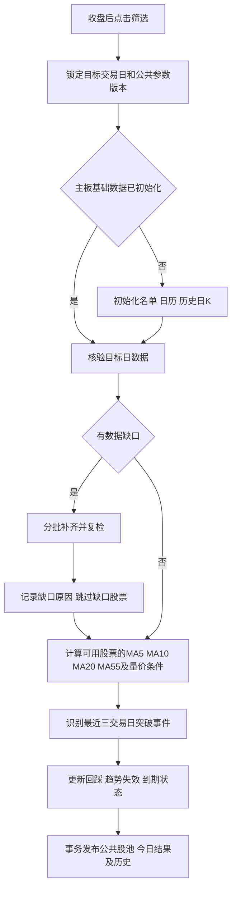

# 55线战法：可行性验证与修订实施计划

验证日期：2026-09-08。适用于“研究与交付 → 战法平台”首版。

实施更新：首版代码、数据库迁移、后台worker和页面已完成。2026-09-09按用户要求跳过个股缺口，已实际处理3195只主板股票并发布9月8日可用结果：3040只参与筛选、154只排除、1只缺口。以下实测表保留实施前基线；实际架构、运行命令和验收边界见 [战法平台实现与运行](tactics-platform.md)。下一真实交易日全池运行仍待验证。

## 1. 结论与实测证据

**实施前验证结论：有条件可行，真实行情获取、现有入库读取、MA55计算成立。** 当时本地尚未初始化正式行情。筛选范围调整为沪深主板A股，不含创业板、科创板、北交所；不能把原300只股票的样本池当成全主板。

| 验证项 | 结果 | 对计划的影响 |
| --- | --- | --- |
| 本地服务 | `127.0.0.1:8000/health` 与股票池摘要接口正常 | 可复用现有market-data服务 |
| 本地基础池 | 300只，按市场及代码分类后212只为沪深主板 | 初始化独立的主板扫描范围 |
| 本地正式数据 | 日K、同步状态、交易日历、补数记录均为空 | 首次必须完成初始化，不能直接进行全主板筛选 |
| 主板名单获取 | Baostock证券主数据返回8945条各类证券记录，其中3195条为在市主板股票，尚含ST；一次查询约31.9秒 | 增加该源的名单适配，不能只复用目前的东财列表入口 |
| 正式日K数据源 | 使用项目现有Baostock适配器获取贵州茅台、广发证券、英维克，每只248根前复权日K，均到9月8日；交易状态、ST字段完整 | 首版正式筛选以Baostock为主源 |
| 备用源 | 腾讯12只主板股票均返回前复权日K，共3852根，均到9月8日 | 可作为交叉核验/诊断源，不直接承担完整安全状态判断 |
| 数据源差异 | 3只股票各248个共同日期，历史收盘价最大相对差异约0.554%、0.472%、0.072%；成交量口径转换后相同 | 不把不同来源的前复权价格拼接成一条计算序列 |
| 未来交易日历 | Baostock直接查询成功返回9月1日至10月15日的45个日历日，包含未来开休市状态 | 数据源可用，但现有刷新服务拒绝未来结束日期，必须扩展 |
| 真实数据入库读取 | 3只股票共744根，通过现有repository写入、重复写入、读回及SQL/Python MA55对比 | 基础链路可复用；重复写入未增生重复K线 |
| 正式表保护 | 上述验证在同一事务中进行并回滚；日K总数由0恢复为0 | 验证没有初始化正式行情或改动基础池 |
| 规则样本 | 12只、约16个月的腾讯历史日K识别5次突破、1次随后两根日K内的回踩；3只Baostock样本的可比事件一致 | 原默认阈值可执行，先保留，不能据此推算胜率 |
| 全主板规模计算 | 3195条模拟股票序列，每条重复同一组80根真实价格，共255600行；临时表装载约0.64秒、窗口计算约2.87秒，随后回滚 | 证明这一规模的SQL指标计算可行，不是3195只真实股票全量筛选测速 |
| 现有测试 | Baostock、交易日历、补数预检、筛选安全相关测试27项通过；独立规则探针16项断言通过 | 业务工作流、到期状态机、并发恢复仍需在实现后验收 |

实测例子：英维克（002837.SZ）2026-08-27满足突破条件，阳线实体约5.38%、成交量为前5日均量的1.67倍；8月28日成交量约为突破日的77.79%，收盘高于MA55约0.66%，符合默认缩量回踩条件。它仅说明量化条件可以命中真实样本，不代表复现原文具体交易，也不构成收益验证。

原始证据和可复跑脚本存放在 `data/validation/ma55-2026-09-08/`：`probe.py`、`report.json`、`db_roundtrip.py`、`db-roundtrip-report.json`、`analyze.py`、`analysis.json` 以及对应原始数据文件。该目录为本地验证产物，不进入版本库。

## 2. 范围与数据准备：先初始化，再进行每日筛选

### 主板边界

- 新增基础扫描池 `cn-mainboard-a-share`，平台共用。保留现有A股样本池和其他业务股票池。
- 先核验证券类型为股票、交易所为上交所/深交所、上市状态有效，再按主板代码白名单过滤：沪市600/601/603/605，深市000/001/002/003。
- 深市原中小板002属于主板，保留；003也保留。拒绝300/301、688/689、北交所、B股、ETF、基金及指数。证券身份冲突或未知时不纳入。
- 此范围为首版产品限制，页面不提供扩大到创业板、科创板或北交所的选项。
- 名单以源端当次完整快照为准，每日检查变更；3195只是本次返回值，不硬编码数量，不视为交易所官方完整性认证。
- 名单同步部分失败时不批量删除既有成员；成功后软标记退市/失效成员，不删除其历史行情。

### 首次初始化

1. 获取完整主板证券名单，保存来源、时间和成员快照。
2. 获取本年度及当前日期后至少30个自然日的真实交易日历，并保证覆盖之后至少两个开市日。年末扩展至下一年度；源端未提供足够日历时显示阻塞，不用星期推算。
3. 分批获取每只股票截至目标日的最近120个市场交易日范围内的前复权日K；计算至少需要60根有效K线。已上市足够久但因停牌不足60根时逐步扩大历史范围，最多回溯一年；仍不足时记录不可评估，不制造K线。
4. 校验日期顺序、重复记录、OHLC、正价格、成交量、ST/交易状态以及复权来源。可明确识别的ST、退市、停牌、历史不足属于排除原因；正常交易证券数据丢失属于缺口。
5. 展示名单数、规则排除数、数据就绪数和缺口数。初始化完成后自动衔接用户发起的收盘筛选。

首次初始化作为可恢复的长任务展示进度，不能塞入一个浏览器HTTP请求。无需为55线先下载全市场五年历史、财报、DDE或分钟数据。

### 每日数据准备

- 更新成员变化，定位目标日缺K线或缺必要状态字段的股票，只对这些股票补齐；已就绪者复用本地数据。
- 同一股票同一计算窗口采用同源、同一次复权口径的数据。增量同步校验与缓存重叠日期，历史价格变化时重拉完整所需窗口并生成新的数据快照，不将新旧复权基准混算。不同来源分别保留来源标识；正式筛选不自动将腾讯价格拼入Baostock窗口。
- 实施时采用完整同源战法窗口作为计算输入，同时写入正式日K和同步状态，排除实时快照；每次运行冻结实际使用的价格窗口、数据版本与参数版本，便于复算。同日复跑复用缓存，跨交易日重拉完整窗口，暂不实现单根增量拼接。
- 腾讯当前抽样接口缺历史ST和交易状态，首版仅作诊断备用。Baostock失败时保留任务缺口并重试，不能仅因腾讯有OHLCV就宣称正式数据完整。
- 原通用补数预检还要求成交额、换手率和涨跌停字段。战法就绪校验只依赖真正需要的OHLCV、身份/状态、时间及复权信息，不因无关因子缺失阻塞筛选。

## 3. 修订后的每日工作流与战法规则

### 运行日与数据门槛

- 上海时间15:00后可发起当日运行，但15:00不是供应商数据已齐的承诺；状态明确区分“已收盘”和“数据就绪”。
- 15:00前允许筛选上一已收盘交易日，跨零点仍可重试；休市日通过真实交易日历定位。页面标明数据日期，提交时冻结日期上限，不能因任务排队跨过收盘而切换目标日。
- 现有日线准备辅助函数默认以18:00为界；战法采用独立的目标日判定，不因此静默筛选昨日数据。非交易日显示最近已收盘交易日。
- 主板范围及状态可评估、必要数据完整的股票才参与判断。初次/日常补数每批25只、同一Baostock会话串行请求，股票间隔至少0.3秒；单次外部操作设60秒硬截止，失败最多额外重试2次并递增等待，避免线程超时后底层socket继续占用。
- 个股数据未到达目标交易日时，记录为缺口并跳过，其余股票继续筛选。用户重跑时重新获取缺口数据，同交易日已校验窗口批量复用。
- 2026-09-09按用户要求调整发布选择：个股缺口不阻止发布可用结果，显示“已完成（跳过缺口）”、实际覆盖和具体原因；不将部分覆盖表示为全池数据齐备。缺口股票旧证据保留但不计作本次候选，不延长事件有效期。公共名单/日历失败或全部股票取数失败时仍保留旧结果。

### 入池与回踩条件

突破日B同时满足：

| 项目 | 默认条件 |
| --- | --- |
| 趋势 | B日MA5 > MA10 > MA20 |
| 突破 | 前一交易观察K收盘≤其MA55，B日收盘>B日MA55 |
| 大阳 | B日收盘/开盘−1 ≥ 3% |
| 放量 | B日成交量/此前5根有效日K平均成交量 ≥ 1.5 |

- MA为包含当日收盘的简单均线；计算前一日MA55时同样要求完整窗口。
- 突破必须发生在最近三个市场交易日之一。不能将几天前停牌前的收盘误称为昨日；恢复交易样本保留停牌说明，缺口必须由交易状态解释。
- 涨停日可作为突破预选，只标记状态，不继承原短线筛选器的涨停剔除规则。

B后的两个市场交易日内，趋势仍满足MA5 > MA10 > MA20，且当日成交量≤B日80%，收盘相对MA55偏离在−3%至+1%，标记“缩量回踩，待人工观察”。

上述数值保留为可调研究参数，未因12只股票的小样本而调优。日线只能近似原文尾盘条件，不确认早盘快速击穿或分钟买点，也不生成买入指令/胜率。

### 两天股池状态

- B为第1天；B+1、B+2为之后两个交易日。B收盘入池，B+2收盘完成最后一次检查后移至历史，不再保留到B+3参与原事件选股。
- 到期日固定依据突破日计算。漏运行后补入只保留剩余窗口；重复点击、回踩命中、窗口内再次突破都不续期。
- 每次运行扫描最近三个交易日，重建遗漏的突破与日状态；按日期依次应用趋势失效规则，不能跨过漏运行日的失效后直接复活。
- 多头排列失效、明确转ST/退市时提前失效；窗口内停牌标记不可评估，仍按市场交易日到期。已失效事件在其原窗口内不复活。
- 即使用户不点击，读取股池时也依据真实交易日历与当前时间计算到期，不依赖扫描任务清理。不执行额外的自动选股。
- 到期日收盘后的结果继续在“今日结果/历史”查看；该日收盘才识别的回踩不显示为明天仍有效。
- 所有交易日期由Asia/Shanghai转换获得。数据库日K时间戳可能显示为前一天16:00 UTC，不能直接截取UTC日期，否则会错算突破日及到期日。

## 4. 模块、接口、存储和任务恢复

- 新入口 `/tactics-platform`，位于“研究与交付”。包含战法目录、公共参数、收盘筛选按钮、运行进度、有效观察池、今日结果和历史记录。首个战法ID `ma55-breakout-pullback`。
- 前端不逐股调用外部行情，不把股票名单交给大模型自由判断；后端固定规则批量计算并输出证据。
- Python行情服务负责证券名单适配、日历、补数、MA55计算，以及公共配置/任务/股池的统一事务持久化；Next.js负责用户鉴权、接口代理和展示。战法表由SQL迁移管理，不建立重复Prisma模型。
- 最小接口：战法目录/详情；公共参数读取修改；发起运行并返回运行ID；读取运行进度；分页读取有效股池/今日结果/历史。接口必须返回实际交易日、来源/版本、扫描覆盖及排除/缺口理由。
- PostgreSQL新增战法配置、运行任务、突破观察事件及每日评估记录；行情基础池成员与短期战法观察事件分开。事件唯一身份为战法+证券+突破日期，已有事件冻结其入池参数版本。
- 新运行使用当前公共参数；已有事件继续按入池版本评估。每次运行结果留存，不因之后参数修改而覆盖历史证据。
- 公共运行每战法只允许一个执行者，使用数据库租约、心跳和互斥锁；重复点击返回当前任务，多人操作不会重复入池或重置有效期。
- 实测代码中的补数通过 `asyncio.create_task` 驻留于API进程。失去心跳后只标记部分完成，不等于自动恢复。因此新增独立战法worker，按股票/批次保存完整目标、进度和重试时间；API重启或子补数任务失效后重新核验缺口并重提剩余股票，不仅盲等旧jobId。
- 为worker增加本地开发启动和独立生产服务配置；Windows Python运行沿用现有Selector事件循环设置。首版不引入新的消息队列产品，使用现有PostgreSQL任务状态即可。
- 完成全部计算后，检查当前任务仍持有有效租约，再以事务提交股池和每日记录；旧worker不得覆盖新结果。数据失败不清空旧池，空命中成功仍正常发布“无新增”。
- 权限沿用 `quant.data.read`、`quant.strategy.run`、`quant.strategy.manage`；主板名单初始化与战法规定范围内的补数属于受控任务步骤，不开放任意数据管理代理。记录公共参数修改人和运行发起人。

## 5. 实施顺序、验收及尚未证明的事项

1. **主板数据准备**：新增名单适配与独立基础池，扩展未来日历范围，建立必要字段校验及可恢复初始化；先小批验证再全池初始化。
2. **固定规则计算器**：实现默认规则、逐日状态与到期逻辑，接入版本化计算证据；复用此验证中的真实样本作回归输入，不依赖测试时实时外网返回。
3. **业务工作流**：落地持久任务、worker、个股缺口隔离与可用结果发布、并发幂等、进程恢复，再实现公共股池。
4. **页面和联调**：补入口、参数面板、股票状态及MA55图表，验证刷新/关闭页面不丢任务，数据日期与覆盖范围清楚可见。

必须验收：

- 主板名单保留002/003，排除300/301/688/689/北交所/B股/ETF/指数；来源异常不能造成成员池误清空。
- 冷启动、全部就绪、部分缺口、当日数据延迟、源端失败、零成交量、历史不足、复权变化、UTC跨日。
- 星期五突破、跨周末/节假日、年末未来日历、漏运行补入、B+2收盘命中后归档、窗口内重复突破不续期。
- 重复点击、多人并发、worker/API分别重启、部分批次成功后续跑、失败保留旧池和旧数据日期。
- SQL/Python均线结果一致，每只股票的命中/排除理由可复算；无目标日之后的价格参与计算。
- 进行一次实际完整主板初始化和一次次日增量运行，记录总耗时、供应商失败率、覆盖率、任务恢复情况，才认定每日全池链路通过验收。

**实施前验证边界**：上述可行性探针没有下载3195只股票的完整历史，也未执行完整UI工作流、后台故障恢复或收益回测。2.87秒仅是模拟规模下的本地SQL计算耗时，不能承诺全流程3秒完成。实施后已通过UI和恢复测试，启动全量初始化；全池验收状态以 [实现文档](tactics-platform.md) 为准。
