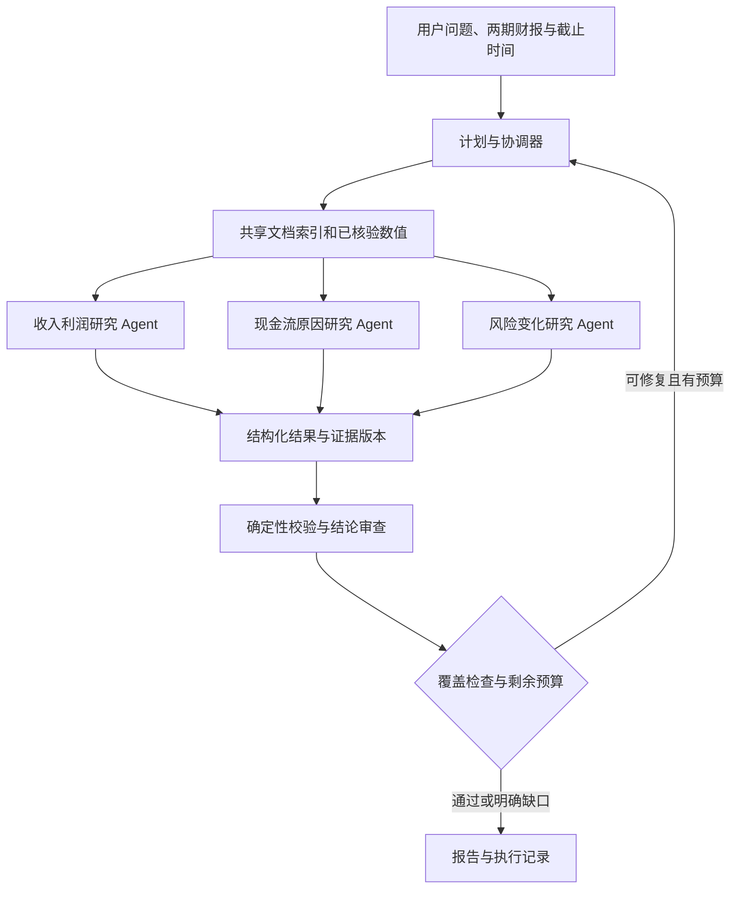

# QuantPilot / wolfbot：面向面试的 Agent 升级提案

日期：2026-10-24（北京时间）

状态：供审阅的方案草案；本次仅整理文档，尚未启动下述开发与模型实验。

现状核对：`e79eac2`，分支 `codex/research-agent-s11-s15`。

目标是在现有财报研究项目中，形成一条能演示、能解释取舍、能用实验验证的 Agent 升级路径：**任务拆分与局部重规划 → 有边界的多 Agent 协作 → 同等资源约束下的质量与成本评测**。

建议首先完成单公司、双期财报场景，再扩展同行比较。开发顺序按依赖安排；面试讲述围绕真实失败、设计选择和验证结果展开。

本提案承接原 [20 步计划](plan.md) 的后续方向，不替代其状态与验收合同。原计划仍以 [progress.md](progress.md) 为准：18/20，S19/S20 仍有质量验收阻塞。本文新增工作的完成不能自动把原步骤改为通过。

## 1. 先看推荐范围

| 优先级 | 升级内容 | 解决的问题 | 可展示的成果 |
| --- | --- | --- | --- |
| P0 | 可执行计划、结构化缺口、局部重规划 | 在检索和重复调用上耗尽预算，留下未核验结论 | 一次原因缺证后的定向补查与局部恢复 |
| P1 | 三个研究 Agent 与协调器 | 不同研究问题争用同一上下文和执行预算 | 分工执行、结构化汇合、冲突处理和父子任务树 |
| P1 | 全局预算、子任务恢复与权限继承 | 并发后成本、失败和状态写入难以控制 | 子任务超时、取消、接管和晚到写入的故障演示 |
| P1 | 单 Agent / 多 Agent 对照实验 | 无法判断收益来自分工，还是更多资源 | 有分母的质量、耗时、Token 与失败归因报告 |
| P2 | 能主动查证的审查 Agent | 一次审查调用只能判断已提供的材料 | 找到反例或缺证后定向检索、核验与停止 |
| P2 | 上下文保真与人工介入 | 长任务遗忘信息，遇到口径冲突无法继续 | 压缩前后行为对照、等待澄清与恢复 |
| P3 | 两至三家公司同行比较、模型路由 | 验证更大任务上的并行价值及成本取舍 | 跨公司任务分解与独立路由实验 |

建议首个可演示版本做到 P0 + 三个研究 Agent + 基础故障治理 + 对照实验。上下文与人工介入的基础边界随主线完成，复杂体验和主动审查在下一阶段扩展。

## 2. 当前基础与真实缺口

以下“已有”指本次检查到的源码或记录；本次没有重新运行产品验收。

| 能力 | 当前事实与依据 | 本轮值得补充的部分 |
| --- | --- | --- |
| 研究循环 | [financial-runtime.ts](../../../src/lib/company-research/financial-runtime.ts) 使用一个 PI 执行引擎，每轮最多一次工具调用 | 子任务拆分、有限并发与独立上下文 |
| 计划与下一步 | [execution-contracts.ts](../../../src/lib/company-research/execution-contracts.ts) 按问题生成步骤；[financial-observation.ts](../../../src/lib/company-research/financial-observation.ts) 提示缺失项和后续动作 | 可校验的依赖、节点完成条件、结构化修复路径 |
| 证据与核验 | 已有事实、引文、确定性校验和单条结论核验 | 共享事实的版本合并，以及子任务结果的冲突处理 |
| 独立审查 | [claim-reviewer.ts](../../../src/lib/company-research/claim-reviewer.ts) 是同模型、独立上下文的一次调用 | 带只读检索工具的审查循环；上下文独立不代表模型错误统计独立 |
| 上下文 | 已有公开 checkpoint、摘要裁剪、按需读取原文 | 按子任务构造上下文，验证压缩后的信息保留与行为变化 |
| 持久化与恢复 | 已有 Worker 租约、心跳、fencing、版本和预算继承，见 [reliability.md](reliability.md) | 将父任务取消、计划修订、额度和执行权传递到子任务 |
| 记忆与审批 | 主平台已有 [用户偏好记忆](../../user-memory-integration.md) 和通用工具审批能力 | 验证研究链路的接入与语义；不能将平台已有能力直接写成研究功能已验收 |

[最近一次开发回归](evaluation-results.md) 的记录是：数值 36/36，问题完成 9/12，结论支持 9/12，整公司完成 2/4。两个原因问题缺少直接支持材料，另一个风险问题未在预算内完成语义核验。这些是小规模、已见开发样本上的记录，不代表总体准确率。

升级首先针对原因证据定位、调用分配与核验完成度。资料本来没有披露原因时，正确结果仍然可以是明确缺口。

## 3. 一个贯穿开发与面试的场景

用户选择一家公司、两期年报和研究截至时间，要求比较收入利润、解释经营现金流变化、识别风险变化，并让每条结论能够定位原文。

执行过程应能展示以下行为：

1. 读取已有文档快照，复用解析和索引；提取并校验共同需要的两期数值。
2. 根据问题建立依赖图，按预算调度收入利润、现金流原因和风险变化三个研究任务。
3. 研究员独立检索、读取、保存结论，返回结构化证据与缺口。
4. 核验发现原因缺证或证据冲突时，只补查受影响的任务。
5. 某个子任务超时或进程退出时，其他已提交结果保留；恢复时承接剩余预算。
6. 输出完整或部分完成的报告，展示缺口、原文定位和各阶段用量。

第一版保留已有独立审查调用；主动检索的审查 Agent 是后续单独加入并评测的变量。协调器第一版采用受控调度代码，后续再允许模型提出补查子任务，由服务端验证后执行。

共享准备不设置“所有数值齐全才能研究”的全局门槛。节点只等待自己的必要依赖；某个金额缺失时，风险研究仍可继续，并在汇合时明确缺口。

## 4. P0：把计划变成可执行、可修复的状态

每个任务节点至少表达：要回答什么、依赖哪些节点、允许哪些工具、输入证据版本、怎样算完成、可用预算和当前状态。

建议的节点状态为 `pending / ready / running / waiting_input / completed / partial / failed / cancelled`。这是一份拟议合同，落地时需要与现有任务状态和数据库迁移设计对齐。

### 依赖与完成条件

“现金流解释”需要两期数值和解释性证据；核验需要已保存的结论与原文；最终提交需要完成覆盖检查。模型返回“完成”只是候选状态，服务端还要核对依赖与验收条件。

确定性计算继续由代码负责。数值提取和检索可以调用模型，但单位、期间、口径与金额计算沿用现有校验，避免不同研究员重复计算出不一致的结果。

### 缺口驱动的局部修复

| 缺口类型 | 后续动作 | 停止条件 |
| --- | --- | --- |
| 检索未命中 | 改写关键词、查财报附注或现金流补充资料 | 达到补查轮数上限，或连续无新增证据 |
| 原文未披露原因 | 标记资料缺口，保留已确认的数值变化 | 无可核查的新来源时停止推断 |
| 期间、单位或口径冲突 | 找表头、注释、重述说明；必要时请求用户澄清 | 冲突未解时禁止合并为一个确定结论 |
| 工具暂时失败 | 有界重试，遵守退避和剩余额度 | 非重试错误、期限到达或重试上限 |
| 结论尚未核验 | 优先安排核验，减少新检索 | 无核验条件或额度时保留未验证状态 |

局部重规划应记录触发原因、受影响节点、保留节点和新计划版本。复用 [update-dependencies.ts](../../../src/lib/company-research/update-dependencies.ts) 已有的依赖失效思路；同一逻辑请求修订或恢复不重置预算。

**验收：**已验证节点不因无关缺口重复运行；循环依赖被拒绝；过期证据使相关结论失效；无证据场景能够有界终止；收尾预算能支持核验与交付。

## 5. P1：多 Agent 的实现边界

### 角色与工具权限

| 角色 | 职责 | 权限边界 |
| --- | --- | --- |
| 协调器 | 分派节点、核对版本、分配额度、收集结果与安排修复 | 服务端决定权限和预算；模型不能自行授予权限 |
| 收入利润研究员 | 比较变化并查找支持解释的原文 | 读取当前任务资料，提交本子任务的事实与结论候选 |
| 现金流研究员 | 核对方向与原因，查找附注或补充资料 | 同上；相关性不能自动写成因果解释 |
| 风险研究员 | 比较两期风险披露及变化 | 同上；未检索到不能等同于风险消失 |
| 审查员（P2） | 验证支持关系，主动寻找反例和遗漏 | 只读检索与提交审查结果，不修改原始证据或直接发布报告 |

三个研究员可以使用同一个模型，区别在于独立上下文、任务目标、工具集合和执行状态。并发度由服务端配置，不要求三个任务始终同时运行。

### 结果交换与共享状态

建议子任务结果包含：`parentRunId`、`subtaskId`、`attemptId`、`planRevision`、`status`、事实与结论候选、证据引用、结构化缺口、用量回执。身份与权限由服务端绑定，不能相信模型填写的 actor、项目或来源范围。

子任务分别写入自己的结果版本，再由协调器事务合并到权威研究状态。共享事实使用稳定标识，至少区分公司、期间、科目、报表口径和来源版本。相同来源与读取范围可复用；缓存也需要校验权限、版本和 asOf。

发现冲突时保留两份原始证据，检查重述、合并口径、单位和披露时间，再定向复核。多个模型赞同同一结果不能替代证据验证。

### 父子任务的预算与故障

- **全局额度：**工具次数、模型请求、Token 和截止时间记入父任务。服务端原子预留、执行后结算；子任务额度总和受父任务约束，核验与收尾留有额度。
- **用量不确定：**请求中断或供应商未返回用量时保留未知状态和保守占额，不能按零成本返还。取消本地任务不代表外部请求一定已停止计费。
- **失败隔离：**只重试失败子任务，已完成结果按版本复用；恢复承接已消耗额度和原期限。
- **执行权：**子任务提交同时校验父计划版本和子任务执行代次；用户取消、修订或 Worker 接管后，旧结果不得提交。
- **一致性：**事件可能重复投递，外部只读请求可能重发；用幂等提交与 fencing 保护状态，不宣称整条系统 exactly-once。
- **终止：**限制并发、子任务总数、委派深度和补查轮数；第一版只允许协调器派生一层任务。

任务树至少展示每个节点的状态、耗时、用量、引用和失败原因。记录公开决策摘要和工具轨迹，不记录隐藏思维链。

**验收：**注入单子任务超时、并发预算耗尽、重复提交、计划修订、父任务取消和旧进程晚到写入，验证不会重复发布、超额派发或覆盖新版本；允许交付真实的 partial。

## 6. P2：审查、上下文与人工介入

### 主动审查

在已有确定性校验和独立审查基础上，为审查员开放当前任务范围内的只读检索与原文读取。审查员可以返回“支持、缺证、冲突”，并附带可定位的依据；需要补证时申请有限子任务，不能无限往返。

生成器聊天历史不进入审查上下文，核验从问题、候选结论、原始证据和明确规则出发。使用同模型时仍可能存在共同偏差；更换审查模型属于另一个实验变量。产品内审查员与评测评分器应分别版本化，不能通过放宽产品审查或评分规则制造提升。

### 上下文与记忆

| 信息类型 | 保存位置与用途 | 失效或纠正方式 |
| --- | --- | --- |
| 任务记忆 | checkpoint：计划、已验证事实、未解决问题、失败查询和预算 | 随计划与证据版本局部失效 |
| 证据资料 | 文档存储与索引：原文、定位、披露时点和来源版本 | 新文档独立版本；不回写旧 asOf 报告 |
| 用户偏好 | 复用现有 Memory：关注领域、输出长度等 | 用户可纠正或停用；偏好不能覆盖事实和证据规则 |
| 方法经验 | 经评测后更新受治理 Skill 或知识条目 | 显式审核、版本发布与回滚；运行失败不直接变成永久记忆 |

压缩上下文时优先保留未完成问题、冲突、单位期间、证据定位和停止条件。已验证金额从结构化状态恢复，长原文按需重读；摘要不能成为事实的唯一依据。

**验收：**设计长文档、跨页单位、否定条件、冲突证据和重复查询场景，比较压缩前后证据找回率、结论支持率与重复调用比例；测试旧版本失效及跨项目隔离。

### 人工介入

适合介入的场景是公司身份歧义、不可比较的报表口径、用户调整问题和明确申请增加研究范围。系统先保存进度，再进入 `waiting_input`，展示具体冲突、可选动作和对结果的影响。

第一版沿用现有同轮次截止时间：等待用户不会偷偷延长期限。回复到达时重新验证版本、执行权和剩余额度；已过期则给出终态与重新发起研究的入口。真正的新研究请求和同轮恢复的预算语义必须分开。

**验收：**刷新和重启后仍可恢复待决事项；重复回复不重复执行；过期决策不能推进新计划；取消能传播到正在运行及等待中的子任务。

## 7. 评测：证明分工带来的收益

在开发前登记样本、基线、评分、预算、允许的实验次数和候选选择规则。旧保留集已经被分析的失败属于已见资料，新验收需要新的未见样本。

| 版本 | 变化 | 想验证什么 |
| --- | --- | --- |
| A | 当前单 Agent | 现有行为与失败基线 |
| B | 单 Agent + 可执行计划 + 收尾预算 | 任务调度本身是否改善质量 |
| C | 在 B 上加入独立研究员与有限并发 | 上下文分工和并发是否有额外收益 |
| D（可选） | 在 C 上加入主动审查 Agent | 主动补证的收益是否值得额外成本 |

A/B/C 在同一冻结资料、模型、评分器与总资源约束下配对运行，协调和审查开销一并计入。全局工具和时间上限可参考现有 40 次 / 20 分钟，Token 或成本上限需在实验前根据实测基线登记；这不修改历史实验预算。若新增调用或调度使固定上限不可行，应另立实验并保留相同新上限下的基线。

固定模型、推理配置、解析版本、检索参数、缓存冷热条件与服务并发。总预算相同不意味着实际消耗相同，因此同时报告真实用量。并发耗时下降可能源于更多同时请求，需要记录并发度和供应商限流影响。

建议样本覆盖：简单单问题、三问综合、原因缺证、口径冲突、资料不足、扫描件、长上下文，以及子任务超时与取消。先做小规模开发对照，再对代表场景重复运行；次数和费用提前登记，不能只保留最好一次。

| 指标 | 统计口径 |
| --- | --- |
| 必需问题完成率 | 已正确回答且有证据支持的必需问题 / 全部必需问题；缺答仍在分母 |
| 结论支持率 | 经冻结规则判为有支持的实质结论 / 全部实质结论，同时报告问题覆盖 |
| 数值与引用质量 | 必需数值正确数、引用定位正确数及各自完整分母 |
| 任务成功率 | 完成全部必要要求且通过硬门的任务 / 所有有效任务；partial 单独列出 |
| 成本与耗时 | 端到端和阶段耗时、模型请求、Token、工具调用、搜索/OCR 成本；未知项明确标注 |
| 每成功任务成本 | 所有运行总成本 / 成功任务数；零成功时不可计算 |
| 冗余与稳定性 | 重复检索、重复核验、重试、死循环终止次数，以及多次运行的结果波动 |
| 恢复与隔离 | 故障后有效结果保留、预算继承、越权和晚到写入是否被阻止 |

每个失败至少能归因到检索、规划、工具、核验、上下文、执行故障或预算。Trace 关联父任务、子任务、attempt 和版本；前端展示任务树，原文正文与敏感数据按现有权限保存。

上线选择先满足既定质量和硬门，再比较成本与耗时。若多 Agent 只在复杂任务上更好，就限定其使用范围；小样本只报告实测结果与不确定性。模型路由在分工效果确认后单独实验。

## 8. 实施顺序与代码落点

以下均为拟议工作包，尚未开工。表内路径是已存在的复用入口；新合同和调度模块的文件名在实施时确定，避免把所有逻辑堆入现有 runtime。

| 工作包 | 依赖 | 交付物 | 完成标准 |
| --- | --- | --- | --- |
| R0：冻结实验合同 | 无 | 样本分层、预算、评分、基线和实验登记 | 生成器不接触答案；费用与重复次数有上限 |
| R1：可执行计划 | R0 | 节点合同、依赖校验、结构化缺口与收尾预算 | 局部修复、无证据停止、预算继承反例通过；完成 B 的对照 |
| R2：父子任务治理 | R1 | 子任务持久化、额度预留、权限绑定、幂等合并与取消 | 隔离数据库的并发、接管和重复提交验证通过 |
| R3：三个研究 Agent | R2 | 独立上下文、工具集、任务树与结果汇合 | 正常、冲突、超时和 partial 场景跑通 |
| R4：对照与展示 | R3 | A/B/C 报告、失败归因和可回放演示 | 固定合同下如实报告质量、成本与并行收益，保留失败 |
| R5：主动审查与体验 | R4 | D 组实验、上下文保真、澄清等待与恢复 | 主动审查收益单独验证；用户旅程与状态反例通过 |
| R6：同行比较与路由 | R4，按需要依赖 R5 | 多公司任务拆分或模型路由实验 | 证明新增能力有收益，仍受父任务总预算与范围约束 |

优先复用的模块：

- 研究合同与循环：`src/lib/company-research/execution-contracts.ts`、`financial-runtime.ts`、`financial-tools.ts`。
- 持久化与执行权：`src/lib/company-research/attempt-store.ts`、`execution-store.ts`、`update-dependencies.ts`。
- 上下文与审查：`src/lib/company-research/financial-observation.ts`、`claim-reviewer.ts`、`src/lib/agent/context/context-manager.ts`。
- 观测与评测：`src/lib/company-research/observability.ts`、`src/lib/eval/`、`scripts/research/run-financial-evaluation.ts`。
- 工作台：`src/app/company-research/` 与 `src/app/api/company-research/`，沿用权威快照和事件恢复机制。

金融规则继续留在研究应用层。可复用的调度机制经边界验证后再下沉到通用层；复用 PI 执行内核和现有服务，不在本提案中要求更换框架、数据库或新增跨服务 Agent 协议。

## 9. 面试问题与应准备的证据

| 面试问题 | 项目中的回答抓手 | 应准备的材料 |
| --- | --- | --- |
| 为什么用 Agent，哪些步骤适合固定工作流？ | 检索与补证有不确定性，金额计算和权限校验确定执行 | 一次完整执行图与工具轨迹 |
| ReAct 与 Plan-and-Execute 如何结合？ | 计划约束依赖与预算，研究员内部按观察选择工具 | 缺口触发局部重规划的前后对比 |
| 为什么需要多 Agent？ | 分离上下文、并行研究与专职核验 | B/C 对照及不适用场景 |
| 协作方式如何选择？ | 第一版协调器分派、结构化结果汇合；不需要任意互聊 | 父子任务合同与一次冲突处理 |
| Agent 和并行工具调用有什么区别？ | 子任务具有独立目标、上下文、权限与多轮循环 | 两个研究员不同的执行路径 |
| 如何防止死循环和成本失控？ | 全局额度、信息增益、委派深度、重试上限与收尾预算 | 重复检索和并发耗尽反例 |
| 如何处理幻觉与审查偏差？ | 确定性检查、原文核验、校准、缺口和独立评分 | 原因缺证、冲突与 reviewer 误判样例 |
| RAG、上下文和 Memory 各负责什么？ | 证据索引、当前任务状态、用户偏好分别管理 | 压缩保真及新版本失效演示 |
| 进程崩溃后如何恢复？ | 持久状态、租约与 fencing，恢复保留预算 | 杀进程接管及旧写入拒绝记录 |
| Prompt 注入和越权如何防护？ | 来源按数据处理，子权限不超过父权限，服务端绑定范围 | 恶意文档和跨项目读取反例 |
| 人工介入后怎么继续？ | 持久等待、决策版本、幂等处理与过期校验 | 澄清、刷新、重复点击和取消旅程 |
| Function Calling、MCP 与 Agent 协作协议如何区分？ | 模型请求工具、工具服务互通、跨 Agent 任务交换是不同层次 | 现有工具合同与本地子任务合同；未实现的协议明确作为设计讨论 |
| 如何证明优化有效？ | 同题配对、资源约束、消融、未见样本及失败全量统计 | A/B/C 结果表与分母、版本、用量记录 |

最终演示建议控制在一条研究任务：展示拆分、并行、一次缺证补查、一次失败恢复和最终报告，再用对照数据解释收益。开发完成后依据实际证据撰写简历，不提前填入提升比例或把本提案写成已实现能力。
