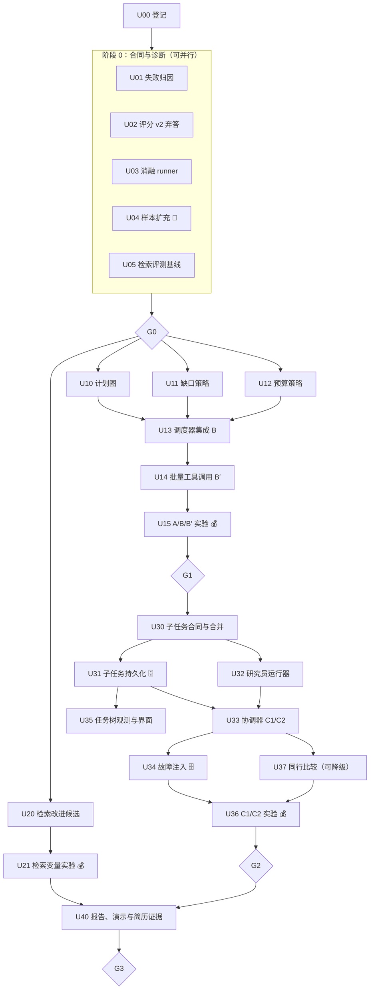

# QuantPilot / wolfbot：Agent 升级实施计划（U 系列）

日期：2026-10-24（北京时间）　版本：v2（据代码评审修订，可直接按工作包派发子 Agent 执行）

现状核对：`26968ff`，分支 `codex/research-agent-s11-s15`。建议新开 `codex/agent-upgrade` 承接本计划。

本计划承接原 [20 步计划](plan.md) 的后续方向，不替代其状态与验收合同。原计划仍以 [progress.md](progress.md) 为准：18/20，S19/S20 有质量验收阻塞。U 系列的完成**不能**自动把 S19/S20 改为通过；若 U 系列结果足以支持重新验收，另行登记新的未见样本和验收批次。

---

## 0. 一页纸摘要

**目标**：在现有单公司双期财报研究 Agent 上，形成一条可演示、可解释取舍、可用实验验证的升级路径：

> 失败归因 → 可执行计划与收尾预算（P0）→ 检索定位改进 → 进程内多 Agent 分工 → 同等资源约束下的消融实验 → 用数据决定多 Agent 的适用范围。

**相对 v1 的关键修订**（来源：代码评审）：

| 修订 | 原因 |
| --- | --- |
| 新增 U01 失败归因、U02 弃答口径 | v1 的多 Agent 动机缺数据；原指标让“原文未披露”永远不得分，P0 收益会被掩盖 |
| 实验组拆为 A / B / B′ / C1 / C2 | v1 的 C 组同时改变上下文隔离、并发、预算切分三个变量 |
| 新增阶段 1.5 检索评测与改进 | 首要失败是“原因证据定位”，而检索为纯 BM25（`zh-context-bm25-v4`），v1 未触及 |
| 多 Agent 明确为**进程内**实现 | 现有一任务一执行者、整块 checkpoint 覆盖写；分布式子任务接管工作量翻倍，降为后备 |
| 同行比较提前为 U37（可降级） | 单公司三问任务只需 25–40 次工具，多 Agent 收益只可能在更大任务上体现 |
| 故障注入全部走 mock provider | 不消耗真实模型预算；真实模型只用于登记过的消融实验 |
| HITL、主动审查、分布式接管、模型路由移入后备 | 控制范围，先交付可度量的主线 |

**主线交付物**：单 Agent 可执行计划（B）、批量工具调用（B′）、三研究员 + 协调器（C1/C2）、故障注入测试集、任务树界面、A/B/B′/C1/C2 消融报告、一条完整演示链路。

---

## 1. 主 AI 调度协议

本节写给负责统筹的主 AI。子 Agent 只需阅读 §2 全局约束和被派发的工作包卡片。

### 1.1 角色

| 角色 | 职责 | 禁止 |
| --- | --- | --- |
| 主 AI（协调者） | 选取可执行工作包、派发子 Agent、审查差异、运行门禁、集成冲突、更新 `progress.md`/`decisions.md`、提交与推送 | 不在子 Agent 运行时改动其写入范围内的文件 |
| 实现子 Agent | 在卡片“写入范围”内完成实现与测试，按 §1.5 模板回报 | 不改写入范围外文件；不提交/推送；不改进度文件；不运行 💰 实验 |
| 验收子 Agent（可选） | 只读，独立按卡片“验收”逐条核对，报告通过/失败与证据 | 不修改代码 |

### 1.2 派发规则

1. **选取**：只派发依赖全部 `done` 的工作包；按 §3 的并行组同时派发。
2. **文件独占**：同时运行的子 Agent 写入范围不得重叠。§4 列出热点文件的唯一所有者；热点文件在同一时刻只属于一个工作包。
3. **标记处理**：
   - 💰 真实模型费用：主 AI 先向用户报告预计 Token 与次数，获批后才运行。
   - 👤 需要用户：人工标注、预算审批、样本授权等，主 AI 汇总成一次性问题向用户提出，期间继续其他工作包。
   - 🗄️ 需要 PostgreSQL：使用 `npm run test:research:postgres` 的隔离库，不能用 mock 宣称 SQL 并发正确。
4. **集成**：子 Agent 回报后，主 AI 审查 diff → 运行卡片验收命令 → 必要时派验收子 Agent → 更新 `progress.md`（状态、`E-Uxx-n` 证据、交接）→ 提交。一个工作包一个提交，提交信息带 `Uxx`。
5. **失败**：验收失败的工作包保持 `in_progress`，把失败输出原样回给同一子 Agent 修复；连续两轮失败由主 AI 介入或拆分工作包。
6. **门禁**：每个阶段结束运行 §3 中的门禁 G0–G3，未通过不进入依赖它的阶段。

### 1.3 状态登记

开始执行前（U00），主 AI 在 `progress.md` 新增“U 系列”小节，每个工作包一行：`ID | 状态 pending/in_progress/blocked/done | 负责会话 | 写入范围 | 证据 | 下一动作`。证据编号 `E-Uxx-序号`，规范同 [development.md](development.md) 的证据留存要求。

### 1.4 子 Agent 派发提示模板

```text
你负责 QuantPilot 仓库的工作包 {Uxx}：{标题}。
1. 先读 docs/plans/research-agent-upgrade/agent-upgrade-proposal.md 的 §2 全局约束与 {Uxx} 卡片；
   按需读卡片列出的只读参考。不需要阅读 20 步计划全文。
2. 只修改卡片“写入范围”中的文件/目录；需要改范围外文件时停下并在回报中说明原因。
3. 按卡片“合同”实现，按“验收”编写并运行测试；记录每条命令的退出码。
4. 不提交、不推送、不修改 progress.md / decisions.md，不运行真实模型（💰）实验。
5. 完成后按 §1.5 回报模板输出。
```

### 1.5 子 Agent 回报模板

```text
工作包：Uxx
结果：完成 / 部分完成 / 阻塞
改动文件：<路径列表，标注新增/修改>
合同变化：<对外接口、schema、迁移；无则写“无”>
验收：<逐条：命令 → 退出码 → 结论>
未运行项及原因：
已知限制 / 风险：
建议的决策记录：<需要写入 decisions.md 的选择；无则写“无”>
```

---

## 2. 全局约束（所有子 Agent 必读）

1. **分层**：`src/lib/agent/`（PI 内核）保持通用，不加入财报、证券、问题 ID 等业务知识；金融规则留在 `src/lib/company-research/`。新逻辑放新文件，不继续扩张 `financial-runtime.ts`、`financial-tools.ts`、`task-contracts.ts`。
2. **不放宽**：不改 v1 评分器、v1 rubric、已冻结证据目录和历史实验结果；不提高 40 次工具 / 20 分钟预算来制造提升；预算变化只能作为独立登记的实验变量。
3. **不编造**：费用未知写 unknown，不写 0；缺失答案留在分母；不把 mock 结果写成真实模型结果。
4. **安全**：身份、actor、项目、来源范围由服务端绑定，不信任模型填写的值；文档内容按数据处理；不持久化或展示隐藏思维链。
5. **一致性**：所有状态写入沿用 `assertResearchAttempt` 式的执行权校验（代次、计划版本、租约）；晚到写入必须失败；只对数据库提交声称幂等，不宣称全系统 exactly-once。
6. **测试**：
   - 研究 TS：`npm run test:unit -- src/lib/company-research` 与 `npm run type-check`
   - 评测：`npm run test:unit -- src/lib/eval`
   - 涉及 `src/lib/agent/` 或跨模块：`npm run check:module-boundaries`
   - 🗄️：`npm run test:research:postgres`
   - 文档：`npm run check:docs`
7. **兼容**：现有 A 变体（当前单 Agent）的行为在默认配置下必须保持不变，已有测试不得删除或弱化。

---

## 3. 阶段、依赖与并行组



| 并行组 | 可同时派发 | 前置 |
| --- | --- | --- |
| PG-0 | U01、U02、U03、U04、U05 | U00 |
| PG-1 | U10、U11、U12、U20 | G0 |
| PG-2 | U13（单独） | U10–U12 |
| PG-3 | U31、U32 | U30 |
| PG-4 | U34、U35、U37 | U33（U35 只需 U31） |

### 门禁

| 门禁 | 通过条件 |
| --- | --- |
| G0 | U01 归因报告完成；rubric v2 与弃答标签冻结并获用户确认 👤；runner 用 mock provider 完成全部变体空跑；实验登记（样本、重复次数、Token 上限、统计方法）获用户批准 👤 |
| G1 | U10–U14 单测、类型检查、PG 测试通过；A/B/B′ 真实结果按登记次数全部保存（含失败）；结论写入 `evaluation-results.md` 新小节 |
| G2 | U30–U35 测试通过；故障注入矩阵全部通过；C1/C2（及 U37 若完成）结果按登记次数保存 |
| G3 | 消融报告、演示脚本、简历证据可复核；`npm run check:docs` 通过；交接写回 |

---

## 4. 热点文件所有权

同一时刻只有一个工作包可写入下列文件。未列出的新文件归创建它的工作包。

| 文件 | 所有者（按时间顺序） |
| --- | --- |
| `src/lib/company-research/financial-runtime.ts` | U13 → U14 → U33 |
| `src/lib/company-research/financial-tools.ts` | U13 → U32 |
| `src/lib/company-research/execution-contracts.ts` | U13 → U33 |
| `src/lib/company-research/financial-observation.ts` | U13 |
| `src/lib/company-research/task-contracts.ts` | U10 → U37 |
| `src/lib/company-research/observability.ts` | U35 |
| `src/lib/company-research/evidence-retrieval.ts`、`lexical-index.ts` | U20 |
| `src/lib/eval/financial-research-score.ts`、`src/lib/eval/statistics.ts` | U02（v1 函数只增不改） |
| `scripts/research/verify-retrieval.ts` | U05 → U20 |
| `prisma/migrations/` 新目录 | U31 → U37 |
| `fixtures/company-research/` 新文件 | U02（标签）、U04（样本）、U05（检索标签） |
| `progress.md`、`decisions.md`、`README.md` | 仅主 AI |

---

## 5. 工作包卡片

卡片字段：**目标 / 依赖 / 写入范围 / 只读参考 / 合同 / 验收 / 标记**。

### U00 登记与分支（主 AI）

- **目标**：建立 `codex/agent-upgrade` 分支；在 `progress.md` 新增 U 系列状态表（§1.3）；核对 `git status` 干净与当前 HEAD。
- **验收**：`npm run check:docs` 通过；状态表包含 U01–U40。

---

### 阶段 0：合同与诊断

#### U01 历史轨迹失败归因

- **目标**：用现有轨迹回答“多 Agent 要解决的问题是否真实存在”，为后续设计和面试提供量化依据。无模型调用。
- **依赖**：U00
- **写入范围**：`src/lib/eval/research-failure-attribution.ts`（+ `.test.ts`）、`scripts/research/attribute-failures.ts`、`docs/plans/research-agent-upgrade/failure-attribution.md`
- **只读参考**：`data/research-agent-upgrade/evidence/S19/` 下各批次的 `<phase>/<case>/tools.jsonl`、`observations.jsonl`、`task.json`、`result.json`；[evaluation-results.md](evaluation-results.md)；[financial-runtime.ts](../../../src/lib/company-research/financial-runtime.ts)
- **合同**：脚本参数 `--campaign=<目录>`（可多次），输出 JSON + Markdown，逐任务统计：
  - 各工具调用次数；按问题（由 claim/fact 的 questionId、metric 推断）的工具消耗分布；
  - 重复检索：相同或高度相似 query 的次数、无新增证据的调用比例；
  - 跨问题切换次数，以及切换后回到原问题时的重复读取；
  - compact 上下文触发次数（若轨迹无法判断，标为“不可观测”，不推测）；
  - 预算耗尽时尚未完成的步骤；
  - 每个失败问题归入一类：`retrieval_miss / not_disclosed / budget_exhausted / verification_pending / context_loss / tool_error / planning`，并附判定依据。
- **验收**：单测覆盖解析、归类和“不可观测”分支；在全部已有 S19 批次上运行成功；报告给出明确结论：上下文争用**有 / 无**数据支持。
- **产出用途**：G0 时主 AI 据此在 `decisions.md` 记录多 Agent 的定位（质量收益 / 延迟与规模收益）。

#### U02 评分器 v2：可回答性与弃答

- **目标**：让“原文确实未披露时正确保留缺口”可以得分，同时防止模型借此偷懒或编造。
- **依赖**：U00
- **写入范围**：`src/lib/eval/financial-research-score-v2.ts`（+ `.test.ts`）、`src/lib/eval/statistics.ts`（只增函数）、`fixtures/company-research/rubric-v2.json`、`fixtures/company-research/answerability-dev-v1.json`
- **只读参考**：[financial-research-score.ts](../../../src/lib/eval/financial-research-score.ts)、`fixtures/company-research/development.json`、`fixtures/company-research/rubric.json`、[human-annotation.md](human-annotation.md)
- **合同**：
  - 标签：每个问题标注 `answerable | not_disclosed`；`not_disclosed` 必须附人工核对过的检索范围（章节/页）作为依据。
  - 指标（全部带分母与 Wilson 区间）：
    - 可回答题支持率 = 可回答且结论被支持 / 全部可回答题
    - 正确弃答率 = 未披露题中以 `evidence_gap` 明确说明缺口 / 全部未披露题
    - 错误断言率 = 未披露题中给出实质性原因断言 / 全部未披露题（硬指标，目标 0）
    - 漏答率 = 可回答题中以缺口结束 / 全部可回答题
    - 数值正确率、任务成功率沿用 v1 定义
  - 配对比较：新增题目级配对 bootstrap 置信区间（或 McNemar），供 A/B/C 比较。
  - v1 评分函数与 rubric 不变；v2 是并列版本。
- **验收**：单测覆盖四种组合（可回答×支持/缺口，未披露×缺口/断言）与零分母；用 v2 重算 `repair-validation-20261020-01` 批次的结果并与 v1 并列输出。
- **标记**：👤 现有 4 个开发案例的弃答标签由主 AI 依据 S19 证据起草（例如五粮液、万华化学现金流原因），用户确认后冻结。

#### U03 消融实验 runner

- **目标**：用一个 runner 在相同资料、模型、评分、预算下配对运行全部变体，并支持 mock 空跑。
- **依赖**：U00（接入 v2 评分时依赖 U02 的接口；可先以接口桩开发）
- **写入范围**：`scripts/research/run-agent-ablation.ts`、`scripts/research/ablation-protocol.ts`（+ `.test.ts`）、`docs/plans/research-agent-upgrade/ablation-registration.md`
- **只读参考**：[run-financial-evaluation.ts](../../../scripts/research/run-financial-evaluation.ts)（沿用其数据库保护、协议 hash、证据目录写法；**不修改**原脚本）
- **合同**：
  - 参数：`--variant=A|B|B2|C1|C2|C2-peer`、`--dataset=<路径>`、`--repeats=n`、`--campaign=<data/research-agent-upgrade/evidence/U-ablation/...>`、`--provider=real|mock`、`--max-input-tokens=<总上限>`。
  - 变体通过 `executeFinancialResearch` 的选项注入（由 U13/U33 实现）；runner 只传参，不自行改运行逻辑。
  - 协议文件记录模型、推理配置、数据 hash、代码 hash、预算、变体、重复序号、并发度、缓存冷热条件；比较阶段协议不一致即拒绝运行。
  - 累计 Token 超出上限时停止后续任务，已完成结果保留，汇总标注“提前停止”。
  - 每次运行输出 `result.json`（含 v1 与 v2 分数、usage、阶段耗时、子任务树摘要），汇总输出 `results.json` 与 Markdown 表。
- **验收**：mock provider 下 A 变体完整空跑；协议不一致拒绝、Token 上限停止、重复序号目录隔离有单测；`ablation-registration.md` 写好登记模板（样本、变体、重复、Token 上限、统计方法、候选选择规则）。

#### U04 样本扩充

- **目标**：把开发集从 4 家扩到至少 12 家单公司案例，并组成至少 4 组同行对（用于 U37）；另建新的未见保留集。
- **依赖**：U00
- **写入范围**：`fixtures/company-research/development-v2.json`、`fixtures/company-research/peer-pairs-v1.json`、`fixtures/company-research/holdout-registration-v2.json`、`data/research-agent-upgrade/evidence/U04/`（受控目录，不提交原始 PDF）
- **只读参考**：`scripts/research/collect-fixtures.py`、`prepare-fixtures.py`、`extract-fixtures.ts`、[evaluation.md](evaluation.md)、[human-annotation.md](human-annotation.md)
- **合同**：
  - 分层覆盖：正常三问、原因未披露、口径/重述冲突、扫描件、长文档；每层至少 2 例。
  - 同行对优先用同行业、同年度的已有案例组合（如两家白酒企业），以减少新增标注。
  - 每例记录 PDF hash、解析回执 hash、弃答标签（U02 格式）。
  - 保留集只登记 hash，内容存放在 `RESEARCH_HOLDOUT_ROOT` 受控目录，不进 Git。
- **验收**：`node --import tsx scripts/research/verify-fixtures.ts` 对新清单通过；数据集 schema 校验通过；人工标注表生成。
- **标记**：👤 人工核对数值与弃答标签；Agent 只负责采集、解析和起草。这是**最长路径**，应最先派发。

#### U05 检索评测基线（原因与风险段落）

- **目标**：量化 BM25 能否找到“现金流原因”“风险表述”所在页，判断检索是否是质量瓶颈。
- **依赖**：U00
- **写入范围**：`fixtures/company-research/retrieval-labels-v2.json`、`scripts/research/verify-retrieval.ts`（只增 `--labels` 与新报告字段）、`data/research-agent-upgrade/evidence/U05/`
- **只读参考**：[lexical-index.ts](../../../src/lib/company-research/lexical-index.ts)、[evidence-retrieval.ts](../../../src/lib/company-research/evidence-retrieval.ts)、已有人工标注引文、U01 输出的真实 query
- **合同**：标签粒度为文件页；每个问题至少 1 条金标页；query 集包含 U01 提取的模型真实 query 和人工编写的规范 query；报告 Recall@1/3/5/10、MRR，按问题类型分列，并记录 k、语料 hash、索引版本。
- **验收**：报告生成；`--profile=baseline-v1` 原有用法不受影响。

#### G0 主 AI 动作

1. 汇总 U01 结论，在 `decisions.md` 记录多 Agent 的定位。
2. 起草实验登记（`ablation-registration.md`），向用户确认 👤：样本数、变体、重复次数、Token 上限。参考估算：约 52.6 万输入 Token/任务（据 `repair-validation-20261020-01`：4 任务共 2,104,212）；
   - 完整方案：5 变体 × 12 例 × 2 次 ≈ 120 次运行，约 6,300 万输入 Token；
   - 最小方案：A / B / C2 × 12 例 × 2 次 ≈ 72 次运行，约 3,800 万输入 Token。
3. 冻结 rubric v2 与弃答标签。

---

### 阶段 1：P0 可执行计划（单 Agent，变体 B / B′）

#### U10 计划图合同

- **目标**：把计划步骤从平铺列表升级为带依赖、完成条件和预算份额的 DAG。纯函数，不访问数据库。
- **依赖**：G0
- **写入范围**：`src/lib/company-research/plan-graph.ts`（+ `.test.ts`）、`src/lib/company-research/task-contracts.ts`（新增 `researchPlanSchema` 的 `schemaVersion: 2` 分支，v1 继续可解析）
- **只读参考**：[execution-contracts.ts](../../../src/lib/company-research/execution-contracts.ts) 中 `initialFinancialPlan`；[update-dependencies.ts](../../../src/lib/company-research/update-dependencies.ts)
- **合同**：
  - 节点：`id, questionId|null, kind(prepare|retrieve|compare|verify|report), dependsOn[], allowedTools[], completion(规则 ID), budgetShare, role(coordinator|income_profit|cash_flow|risks)`。
  - 状态：`pending / ready / running / waiting_input / completed / partial / failed / cancelled`（`waiting_input` 本期只保留枚举）。
  - 函数：`buildFinancialPlanV2(spec)`、`validatePlanGraph(plan)`（拒绝环、悬空依赖、重复 ID）、`readyNodes(plan, states)`、`invalidateDownstream(plan, nodeId)`、`revisePlan(plan, change) → {plan, retained[], invalidated[]}`。
  - 共享准备节点 `prepare-facts` 只是现金流、收入利润节点的依赖；风险节点不依赖它（不设“全部金额齐全才能研究”的全局门槛）。
- **验收**：单测覆盖环检测、局部失效只影响下游、已完成节点在无关修订中保留、v1 计划仍能解析。

#### U11 结构化缺口与修复策略

- **目标**：把“缺什么、下一步做什么、何时停止”从提示词文字变成可测试的策略表。纯函数。
- **依赖**：G0
- **写入范围**：`src/lib/company-research/gap-policy.ts`（+ `.test.ts`）
- **合同**：
  - 缺口类型：`retrieval_miss / not_disclosed / period_unit_conflict / tool_transient / unverified_claim / budget_exhausted`。
  - `classifyGap(observation, state)` → 缺口；`repairAction(gap, budget)` → `{action, targetNodeId, maxAttempts, stopWhen}`。
  - 停止规则：同一缺口连续 N 次无新证据（以新增 locator/证据 hash 计，而不只看调用参数是否相同）→ 转为 `not_disclosed` 或 `partial`；冲突未解时禁止合并成确定结论。
- **验收**：每类缺口至少一个正例和一个停止用例；“换关键词但无新证据”能被识别为停滞（现有 `stalledCalls` 只能识别完全相同的调用）。

#### U12 预算策略与收尾预留

- **目标**：解决“预算耗尽时核验未完成”。纯函数。
- **依赖**：G0
- **写入范围**：`src/lib/company-research/budget-policy.ts`（+ `.test.ts`）
- **合同**：
  - `reserveForClosure(spec, state)`：按未核验结论数预留 `verify_claim` 次数，再加 `check_coverage` 与 `submit_report` 各 1 次；
  - `allowedNow(tool, remaining, reserve)`：剩余额度进入预留区后只允许核验与收尾工具；
  - `nodeSoftCap(plan, nodeId, total)`：按 `budgetShare` 给出软上限，超出时把剩余额度让给未完成节点；
  - 预算是父任务全局计数，策略只做分配，不改变总额（总额仍由 `reserveResearchToolCall` 原子扣减）。
- **验收**：单测覆盖万华化学式场景（仍有未核验结论时，第 38 次起只允许核验与收尾）；零剩余、全部已核验、预留超过剩余等边界。

#### U13 调度器集成（变体 B）

- **目标**：把 U10–U12 接入单 Agent 运行时，形成变体 B；默认配置下保持 A 的行为不变。
- **依赖**：U10、U11、U12
- **写入范围**：`src/lib/company-research/financial-scheduler.ts`（新，+ 测试）、`financial-runtime.ts`、`financial-tools.ts`、`execution-contracts.ts`、`financial-observation.ts`、`financial-runtime.integration.test.ts`
- **合同**：
  - `executeFinancialResearch` 增加 `options.variant: 'A' | 'B' | 'B2' | 'C1' | 'C2'`，默认 `'A'`。
  - checkpoint `schemaVersion: 2`：新增 `nodes`（节点状态）、`gaps[]`、`planVersion`、`closureReserve`；v1 checkpoint 读取时自动升级，写回仍校验请求/计划版本绑定。
  - B 变体：`nextAction` 由 `readyNodes` + `repairAction` 生成；工具调用前经 `allowedNow` 检查，被拒绝时返回结构化提示而不扣减额度；局部重规划写一条 `plan.revised` 事件（触发原因、受影响节点、保留节点）。
  - 同一逻辑请求的修订或恢复不重置预算。
- **验收**：
  - 测试 provider 覆盖：原因缺证 → 定向补查 → 有界停止并标记 `not_disclosed`；预算进入预留区后只核验与收尾；已验证节点在无关缺口修复中不重跑。
  - A 变体的现有单测和集成测试全部通过且不修改断言。
  - `npm run test:unit -- src/lib/company-research`、`npm run type-check`、🗄️ `npm run test:research:postgres`。

#### U14 批量工具调用（变体 B′）

- **目标**：回答“Agent 和并行工具调用有什么区别”时有数据可依。
- **依赖**：U13
- **写入范围**：`financial-runtime.ts`、`financial-scheduler.ts`
- **事实前提**：PI 内核在同一轮内**顺序**执行工具（`run-engine.ts` 中 `executionMode: 'sequential'`），因此 B′ 的收益是减少模型往返轮数（每轮都要重发上下文），而不是工具并发执行。不修改 PI 内核。
- **合同**：B2 变体 `maxToolCallsPerTurn` 设为可配置（默认 3）；每次调用仍单独预留额度；同一轮中改变状态的工具（`record_fact / record_claim / verify_claim / check_coverage / submit_report`）最多 1 个，且必须排在只读工具之后，违反时返回结构化错误。
- **验收**：测试 provider 下一轮多次检索的预算扣减、顺序约束、停滞检测正确；报告字段新增“模型轮数”。

#### U15 A / B / B′ 实验 💰

- **目标**：按登记运行，得出“调度本身”和“批量调用”的收益。
- **依赖**：U14、U03、G0 登记
- **执行者**：主 AI（或获批后派给子 Agent），用户批准 Token 上限后运行。
- **写入范围**：`data/research-agent-upgrade/evidence/U-ablation/`、`evaluation-results.md` 新小节“U 系列 A/B/B′”
- **验收**：按登记次数全部保存，含失败与提前停止；报告 v1 与 v2 指标、Token、模型轮数、耗时、工具次数、失败归因；不只保留最好的一次。

---

### 阶段 1.5：检索定位（与阶段 2 文件不重叠，可并行）

#### U20 检索改进候选

- **目标**：若 U05 显示原因/风险段落召回不足，按成本从低到高试验改进方案。
- **依赖**：G0（需要 U05 基线）
- **写入范围**：`src/lib/company-research/retrieval-expansion.ts`（新，+ 测试）、`evidence-retrieval.ts`、`lexical-index.ts`、`scripts/research/verify-retrieval.ts`
- **候选（按顺序，有效即停）**：
  1. 财报同义词与问题模板查询扩展（确定性，零模型成本）；
  2. 章节感知加权（如“管理层讨论与分析”“现金流量表补充资料”“可能面对的风险”）；
  3. 混合检索或 rerank——需要新模型/服务时，先按 [development.md](development.md) 要求写决策：具体缺口、替代方案、开发集结果。
- **合同**：检索结果附 `retrievalVersion`；新版本作为独立变量，默认仍为 `zh-context-bm25-v4`，通过选项切换。
- **验收**：在 U05 标签上 Recall@5 / MRR 有提升且不降低数值类查询的命中；开发集调参不得当作保留集结果。

#### U21 检索变量实验 💰

- **依赖**：U20、U15
- **合同**：在最优单 Agent 变体上只切换检索版本，单独报告，不与 B/C 的收益混算。
- **验收**：同 U15 的保存与报告要求。

---

### 阶段 2：进程内多 Agent（变体 C1 / C2）

**实现路线（已定）**：一个 Worker 持有父任务租约，在进程内运行协调器和 N 个研究员引擎。每个子任务有独立的状态切片、上下文、工具白名单和执行代次；结果先写入子任务表，再由协调器在事务中合并到权威 checkpoint。跨 Worker 认领和接管子任务列入后备 U53。

#### U30 子任务合同与结果合并

- **目标**：定义子任务的输入输出和确定性合并规则。纯函数。
- **依赖**：G1
- **写入范围**：`src/lib/company-research/subtask-contracts.ts`、`src/lib/company-research/subtask-merge.ts`（各带测试）
- **合同**：
  - `SubtaskResult`：`taskId, parentAttemptId, subtaskId, nodeId, generation, planRevision, status(completed|partial|failed|cancelled), facts[], claims[], gaps[], usage{toolCalls, inputTokens|null, outputTokens|null, unknownRequests}`。身份字段由服务端填写，模型输出中的同名字段丢弃。
  - 共享事实键：`company + period + metric + scope + documentId:version`。同键同值去重；同键不同值 → 保留两份证据，状态 `conflict`，关联结论降级为缺口。
  - 合并幂等：同一 `(subtaskId, generation)` 重复合并结果不变；旧 `generation` 或旧 `planRevision` 的结果拒绝。
  - claim 只能属于该子任务的 `questionId`，越界拒绝。
- **验收**：单测覆盖去重、冲突、幂等、旧代次拒绝、越界 claim、partial 合并。

#### U31 子任务持久化与执行权 🗄️

- **目标**：把子任务状态、预算、取消和 fencing 落到数据库。
- **依赖**：U30
- **写入范围**：`prisma/migrations/<时间戳>_research_subtasks/`、`src/lib/company-research/subtask-store.ts`、`subtask-store.integration.test.ts`
- **只读参考**：[attempt-store.ts](../../../src/lib/company-research/attempt-store.ts)、[execution-store.ts](../../../src/lib/company-research/execution-store.ts)、[reliability.md](reliability.md)
- **合同**：
  - 表 `company_research_subtasks`：`id, task_id, parent_attempt_id, node_id, plan_revision, generation, status, tool_calls, input_tokens, output_tokens, unknown_model_requests, result jsonb, error, started_at, finished_at`；唯一约束 `(task_id, node_id, generation)`。
  - `startSubtask / commitSubtaskResult / cancelSubtasks / reserveSubtaskToolCall`：每次都先 `assertResearchAttempt`（父执行权），再校验子任务代次与计划版本。
  - 工具预算：父任务 `tool_calls` 仍是唯一全局计数，`reserveSubtaskToolCall` 在同一事务中同时增加父计数和子任务计数；父任务总额耗尽即全部拒绝。
  - 父任务取消或计划修订 → 运行中的子任务置为 `cancelled`，其后提交失败。
  - 子任务不单独持有租约，心跳仍由父 attempt 负责。
- **验收**：🗄️ 隔离库测试：并发预留不超额、父取消后子提交失败、计划修订后旧子任务提交失败、重复提交幂等、迁移可在空库与现有库上执行。

#### U32 研究员运行器

- **目标**：每个研究员是独立的 PI 引擎实例，拥有自己的上下文、工具白名单和状态切片。
- **依赖**：U30（U31 提供存储接口；可先用接口桩并行开发）
- **写入范围**：`src/lib/company-research/financial-researcher.ts`、`src/lib/company-research/researcher-tools.ts`、`src/lib/company-research/researcher-prompts.ts`（均带测试）、`financial-tools.ts`（只做抽取重构：把各工具的执行逻辑拆成可复用处理函数，A/B 行为不变）
- **合同**：
  - `runResearcher({ role, node, sharedFacts, budget, signal, store }) → SubtaskResult`。
  - 工具白名单：只读检索与读取、`record_fact`（仅限本角色相关指标）、`record_claim`（仅限本 questionId）、`verify_claim`、终止工具 `finish_subtask`；不包含 `submit_report`、`discover_filings`、`import_filing`。
  - 上下文只含本问题、共享已核验数值、本子任务的 checkpoint 切片，不含其他研究员的对话。
  - 每次工具调用经 U31 `reserveSubtaskToolCall` 扣减；每次模型请求沿用 `reserveResearchModelRequest / settleResearchModelUsage`。
- **验收**：测试 provider 下三种角色各自跑通；越权工具被拒绝；A/B 变体全部既有测试通过。

#### U33 协调器（变体 C1 / C2）

- **目标**：协调器按计划图调度研究员、合并结果、执行核验与局部重规划、交付报告。
- **依赖**：U31、U32
- **写入范围**：`src/lib/company-research/financial-coordinator.ts`（+ 测试）、`financial-runtime.ts`（只增加 C1/C2 分支入口）、`execution-contracts.ts`（checkpoint 增加子任务引用）
- **合同**：
  - 第一版协调器是**确定性代码**，不是模型；只派生一层子任务。
  - 流程：`prepare-facts`（共享数值）→ 按 `readyNodes` 派发研究员 → 合并（U30）→ 覆盖检查 → 可修复缺口且有预算时，只对受影响节点重新派发（新 generation）→ 组装并提交报告（复用 `assembleFinancialReport`、`commitResearchReport`）。
  - C1：并发度 1（串行，只隔离上下文）；C2：并发度 3。预算分配用 U12 的 `nodeSoftCap` 与收尾预留，协调和核验开销计入同一总预算。
  - 限制：子任务总数、补查轮数、委派深度 = 1。
- **验收**：测试 provider 下正常、冲突、单子任务超时（其余结果保留，交付 partial）、补查后成功四种场景跑通；`npm run test:unit -- src/lib/company-research`、`npm run type-check`。

#### U34 故障注入测试 🗄️

- **目标**：证明并发和故障下不会超额、不会重复发布、旧结果不会覆盖新版本。全部使用 mock provider。
- **依赖**：U33
- **写入范围**：`src/lib/company-research/multi-agent-faults.integration.test.ts`、必要的测试夹具
- **故障矩阵**（每项一个用例）：单子任务超时；并发预算耗尽；同一结果重复提交；运行中计划修订；父任务取消；父 attempt 租约丢失后子任务晚到写入；Worker 进程中断后由新 attempt 恢复（已提交的子任务结果复用、预算承接）；文档中嵌入恶意指令（工具和权限不受影响）。
- **验收**：🗄️ 全部通过；结果写入 `reliability.md` 的新小节由主 AI 负责。

#### U35 任务树观测与界面

- **目标**：前端可看到父子任务树：状态、耗时、用量、引用和失败原因。
- **依赖**：U31
- **写入范围**：`src/lib/company-research/observability.ts`（事件增加 `subtaskId / nodeId / role`）、`src/app/api/company-research/` 下快照投影的相关文件、`src/app/company-research/financial/` 下新的任务树组件
- **合同**：沿用权威快照 + 事件恢复机制；刷新或重连后从快照重建任务树；不展示隐藏思维链，只展示公开决策摘要和工具轨迹。
- **验收**：状态逻辑单测；类型检查；真实浏览器刷新 / 重连 / 取消的截图证据。

#### U37 两公司同行比较（推荐，可降级）

- **目标**：提供多 Agent 预期占优的“复杂任务”分层。
- **依赖**：U33、U04 的同行对
- **写入范围**：`task-contracts.ts`（新增 `kind: 'financial_peer'`：2 家公司 × 相同两期 × 三问 + 1 条跨公司比较结论）、`src/lib/company-research/peer-coordinator.ts`、迁移（如需）、评分 v2 的同行扩展函数
- **合同**：协调器按公司拆出两组研究员，复用单公司研究员；跨公司比较结论只能引用两侧已核验的事实；总预算单独登记（同一预算同时用于 A 与 C2 的同行任务）。
- **降级**：时间不足时只做评测 runner 层的“两次单公司运行 + 合并比较”，并如实说明不是同一父任务。
- **验收**：测试 provider 下跑通；U03 的 `C2-peer` 变体可运行。

#### U36 C1 / C2 实验 💰

- **依赖**：U34、U35；U37（若完成）
- **合同**：与 U15 相同的样本、模型、评分和总预算；增加同行分层（A vs C2-peer）；记录实际并发度与供应商限流。
- **验收**：同 U15；报告必须回答：上下文隔离（B→C1）、并发（C1→C2）、任务规模（单公司 vs 同行）各自的收益与成本。

---

### 阶段 3：交付

#### U40 消融报告、演示与简历证据

- **依赖**：G2、U21
- **写入范围**：`docs/plans/research-agent-upgrade/ablation-report.md`、[delivery.md](delivery.md) 中的演示小节；主 AI 更新 `README.md`
- **合同**：
  - 消融报告：分母、区间、配对比较、Token、耗时、失败归因、不适用场景；明确多 Agent 的启用范围，例如“仅同行比较启用”。
  - 演示脚本：一条任务展示计划图、并行研究员、一次缺证补查、一次子任务失败恢复、最终报告与任务树。
  - 简历证据：每条描述对应一个证据编号，数字全部来自报告。
- **验收**：G3。

---

## 6. 后备工作包（主线完成后按需启动）

| ID | 内容 | 前置 | 备注 |
| --- | --- | --- | --- |
| U50 | 主动审查 Agent（变体 D）：只读检索、找反例、申请有限补证 | G2 | 作为单独变量实验；审查员与评测评分器分别版本化 |
| U51 | 上下文保真实验：压缩前后证据找回率、支持率、重复调用比例；测量提示词缓存命中率 | G1 | 把稳定前缀与每轮变化的 checkpoint 分开，可以得到具体的成本数据 |
| U52 | 人工介入 `waiting_input`：口径冲突澄清、刷新恢复、重复回复幂等、过期决策拒绝 | G2 | 等待用户不延长原截止时间 |
| U53 | 分布式子任务：子任务独立租约、跨 Worker 认领与接管 | G2 | 工作量大；面试中可作为设计讨论题 |
| U54 | 模型路由：研究员与核验使用不同模型 | U36 | 分工效果确认后单独实验 |
| U55 | 只读研究工具 MCP server | U32 | 让“Function Calling / MCP / Agent 协作”三层区分有实物 |
| U56 | 评审模型与人工标注一致性（κ / 混淆矩阵） | U04 人工标注 | 成本低，回答“LLM 评审是否可信”的追问 |

---

## 7. 评测合同摘要

完整登记在 U03 的 `ablation-registration.md` 中完成，G0 冻结。

| 变体 | 变化 | 回答的问题 |
| --- | --- | --- |
| A | 当前单 Agent | 基线 |
| B | + 计划图、结构化缺口、收尾预留 | 调度本身是否有用 |
| B′（B2） | B + 每轮多次工具调用（顺序执行） | 减少模型往返能省多少；与多 Agent 的区别 |
| C1 | B + 三研究员串行 | 上下文隔离本身的收益 |
| C2 | C1 + 并发 3 | 并发的耗时收益与限流代价 |
| C2-peer | 同行比较任务上的 C2，对照同任务 A | 任务规模是否改变结论 |
| R（U21） | 最优单 Agent + 检索新版本 | 检索改进的独立收益 |

- 固定：模型、推理配置、解析版本、检索参数（除 R 外）、缓存冷热条件、总预算（40 次工具 / 20 分钟；Token 上限在 G0 登记）。
- 指标：U02 的 v2 指标 + 数值正确率 + 任务成功率 + Token / 模型轮数 / 工具次数 / 耗时 / 每成功任务成本 + 失败归因。
- 统计：单比例用 Wilson 区间，变体比较用题目级配对 bootstrap；小样本只报告实测结果与不确定性，不宣称显著。
- 选择规则：先满足硬门与质量要求，再比较成本和耗时；多 Agent 只在被证明有收益的分层中启用。
- 开发集调优后，最终结论需在新登记的未见保留集上验收。

---

## 8. 面试问题与对应证据

| 面试问题 | 项目中的回答抓手 | 证据来源 |
| --- | --- | --- |
| 为什么需要多 Agent？ | 先做失败归因，再决定定位 | U01 报告、U36 结果 |
| 何时不该用多 Agent？ | 单公司三问上的 C vs B 结果 | U36、U40 |
| Agent 与并行工具调用的区别？ | B′ 与 C 的对照；PI 顺序执行的事实 | U14、U15、U36 |
| ReAct 与 Plan-and-Execute 如何结合？ | 计划图约束依赖和预算，节点内按观察选择工具 | U10、U13、局部重规划事件 |
| 如何防止死循环和成本失控？ | 信息增益停滞、收尾预留、全局原子预算、委派深度 1 | U11、U12、U31、U34 |
| 幻觉与弃答怎么处理？ | 可回答性标签、正确弃答率、错误断言率 | U02、U15 |
| RAG 检索怎么评估和优化？ | Recall@k / MRR 基线与候选改进 | U05、U20、U21 |
| 多 Agent 并发写如何保证一致？ | 子任务代次、父执行权 fencing、幂等合并、冲突保留 | U30、U31、U34 |
| 进程崩溃后如何恢复？ | 租约与 fencing，已提交子任务复用，预算承接 | U34、[reliability.md](reliability.md) |
| Prompt 注入与越权？ | 服务端绑定身份、角色工具白名单、恶意文档用例 | U32、U34 |
| LLM 评审是否可信？ | 校准回执、与人工一致性 | 现有校准、U56 |
| 如何证明优化有效？ | 登记、配对、消融、未见样本、全量保留失败 | U03、U40 |

简历只采用 U40 中有证据编号的结论；开发完成前不预填提升比例，也不把本计划写成已实现能力。
