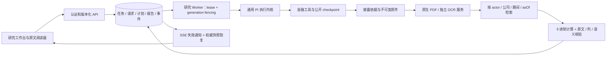
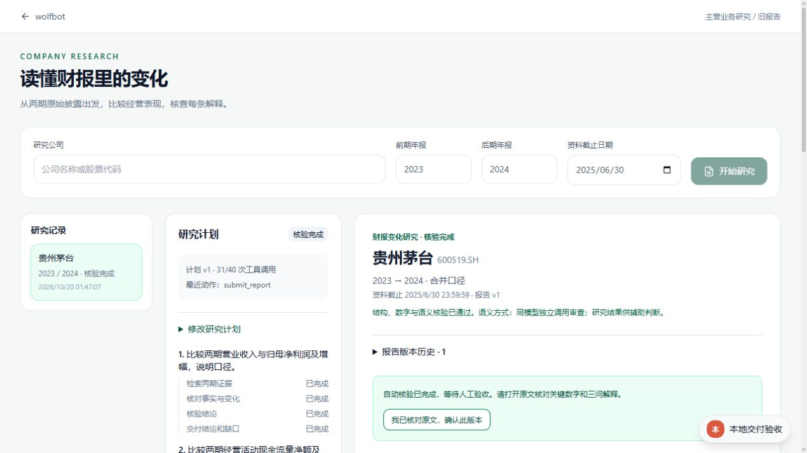
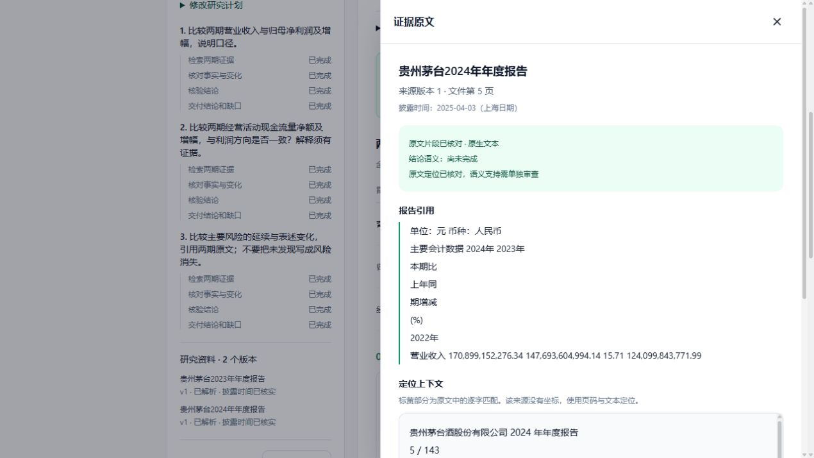
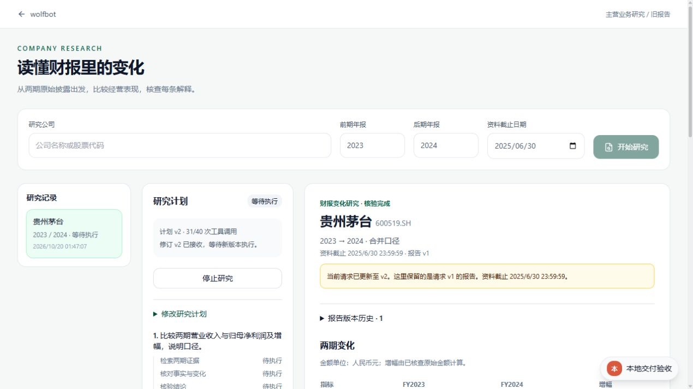
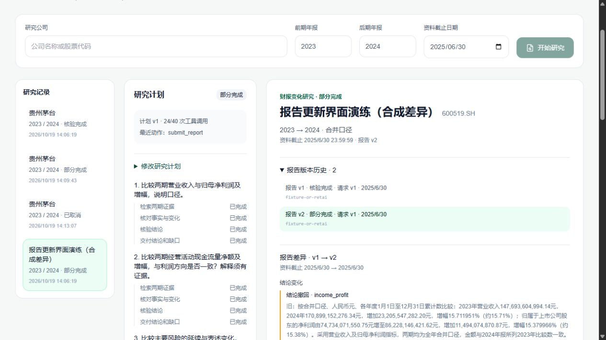

# 财报变化研究：交付与面试演示

这个项目展示从两期原始财报到可核对结论的完整应用：用户查看计划、修改研究问题、点击原文，再用报告历史理解新增证据带来的修订。实现范围与验收状态以 [进度](progress.md) 为准；发布门失败和待人工核查的结果不能当作 20 步全部验收通过。

## 实现边界与架构

复用 Next.js、PostgreSQL、已有研究 Worker 和 PI loop。金融计算、证据策略与研究 prompt 属于应用层；PI 内核不包含证券代码或财报规则。没有另建 Agent 框架、共享向量数据库或监控平台。



`completed` 表示机器核验完成，人工验收是绑定报告 hash 的独立操作。OCR/复杂表格未复核时保留缺口。用户主动更新，原报告不可改写；修订与接管继承同一逻辑任务的工具、Token 和 deadline。

## 3—5 分钟演示脚本

| 时间 | 操作 | 要说明的工程判断 |
| --- | --- | --- |
| 0:00—0:40 | 打开 `/company-research`，选择一家公司、2023/2024 年报和资料截止日 | 问题、期间、披露时点分别建模，截止日不由搜索排序推断 |
| 0:40—1:30 | 展示三问公开计划、金额变化表和一条现金流解释 | 原值与单位保留，变化用十进制确定性计算；金额相关不等于因果 |
| 1:30—2:15 | 点金额/结论旁“原文”，展示来源版本、页码、hash 和逐字高亮 | 引用存在、数值列正确、结论语义支持是三层检查 |
| 2:15—2:55 | 修改风险关注问题，提交修订；刷新页面 | expectedRevision / 幂等 / fencing 防止旧执行覆盖，刷新从数据库恢复 |
| 2:55—3:40 | 展示主动更新、报告 v1/v2、撤回或支持差异 | 新资料有新 asOf；原版保持可读。界面合成案例必须现场说明其性质 |
| 3:40—4:30 | 展示真实进程中断证据与评测表 | 接管保留未知用量和原预算；展示分子/分母、失败和小样本限制 |

用离线存档演示时，开场明确“真实模型报告存档重放”；不要现场假装模型正在运行。报告差异 fixture 明确为合成撤回，不计入模型质量。人工验收按钮留给实际核对者，演示自动化不得代签。

### 实际界面

下列前三张来自启用认证的 Next/API/隔离 PostgreSQL：S19 首批真实模型报告原样恢复，报告 hash 和 reviews 不变；没有启动新的模型 Worker，也没有新增人工签字。







修改问题的完整表单另见 [修订界面](assets/plan-revision.jpg)。实际旅程验证匿名 401、登录、报告读取、来源页、修订 API 202、刷新恢复与取消；原始记录在 `S20/journey-0a0cbf89-189f-4558-aa5c-4b6a68b51d9a/`。停止后临时 PG 的 manifest 记录 `nativeClusterStopped=true`。



最后一张来自 S17 明确标注的合成更新 fixture：用于演示旧版保留与撤回差异，不是实际重述公告或新模型运行。对应真实 PG 的 no-op、晚披露、数字/支持/撤回断言见 E-S17-01。

## 启动、复现与资料恢复

首次环境按 [配置](../../configuration.md) 和根 README 启动数据库/Web。研究 Worker 独立运行：

```powershell
node --import tsx scripts/workers/company-research-worker.ts
# 单次领取一项当前可运行任务：
node --import tsx scripts/workers/company-research-worker.ts --once
```

研究网关使用 `COMPANY_RESEARCH_BASE_URL/MODEL/REASONING/API_KEY`，语义审查需有效的 `COMPANY_RESEARCH_REVIEW_CALIBRATION`。默认每任务 40 工具 / 20 分钟，费用无计价依据时显示未知。具体 HTTP 和状态语义见 [公司研究](../../company-research.md)、[API](../../api-reference.md) 与 [运行恢复](reliability.md)。

固定公开资料按 [评测合同](evaluation.md#复验与恢复) 恢复，取得后核对原件 SHA；不要用最新公告替换冻结 bytes。OCR 模型、派生扫描与大证据另按受控清单恢复。保留集仅在候选冻结后读取，题目、答案、原始报告与凭据都不进入普通代码交接。

隔离数据库与模型实验：

```powershell
npm run test:research:postgres
# Docker 不可用时，只能显式指定可信 PostgreSQL 二进制：
npm run test:research:postgres -- --native-postgres=<trusted-bin>
```

真实评测的基线、候选、freeze、保留与成本口径见 [evaluation-results.md](evaluation-results.md)。中断演练见 [reliability.md](reliability.md)，不要改 SQL lease 时钟或重置 deadline 来制造恢复成功。

### 有认证的本地演示验收

`scripts/checks/run-research-delivery.ts` 只能由隔离 PG runner 启动。它拒绝非 `research_test` 数据库，只允许任务的临时校验 checkout，创建独立的本地测试管理员和 Next dev 服务。报告、reviews、原件和原始 hash 从已完成的 S19 开发存档恢复；不启动模型 Worker、不代签人工验收。

先准备包含当前源码及依赖的独立校验 checkout，避免构建与日常服务共用 `.next`，再显式指定：

```powershell
$env:RESEARCH_DELIVERY_CHECKOUT='<repo>/tmp/research-s16-s20/release-worktree'
$env:RESEARCH_DELIVERY_ARCHIVE='<repo>/data/research-agent-upgrade/evidence/S19/<campaign>/baseline/<dev-case>/task.json'
npm run test:research:postgres -- --native-postgres=<trusted-bin> --delivery
```

监听地址、匿名 401 结果、报告 hash 和 stop 文件位置写入本批 `S20/journey-*/runtime.json`；Next 日志留在同目录。只用这座临时库的本机开发管理员登录。完成读取、原文、修订、刷新与取消后创建 runtime 指定的 stop 文件，runner 会停止自己的 Next 和临时 PG，证据目录保留。此流程验证实际认证/Next/API/PG 用户旅程；模型生成质量由独立 S19 实验承担，不混称一次全程实时生成。

## 证据与适用限制

| 证据 | 能支持的结论 | 不能支持的结论 |
| --- | --- | --- |
| [S19 配对实验](evaluation-results.md) | 固定开发资料、相同模型/工具/预算下的实际结果及一个候选取舍 | 全市场准确率、统计显著或 3×3 稳定性 |
| [S18 进程恢复](reliability.md) | 真实 SIGKILL、自然 lease 到期、generation 接管与旧写入拒绝 | Provider 隐藏会话恢复、外部请求 exactly-once |
| [S11—S15 证据](s11-s15-validation.md) | 真实模型案例、原文定位、SSE 和来源阅读器 | 任意中文扫描版面的自动通过 |
| S17 更新 fixture / 隔离 PG | 数字/支持/撤回差异、无变化 no-op、晚披露隔离、旧版保留 | fixture 是真实重述公告或新模型成绩 |

发布检查及浏览器结果见 `progress.md` 的 E-S20-01。本轮只做开发交付和代码同步；生产部署、生产数据迁移和定时订阅是后续独立工作。Quality 的 Node 锁文件与 Python 依赖审计仍按用户要求暂缓，不能把源码 push 成功说成完整 CI 通过。

### 当前发布检查限制

Windows 独立 checkout 上第三轮 `release:check` 已通过前 17 项，包含四模板真实构建、模块边界和全量 ESLint；全量 Vitest 为 **1418 passed / 35 failed / 71 skipped**，因而整个发布门失败。失败原件是 `evidence/s20-release-03.log`，对应源码清单为 `S20/validation-snapshot-v3.json`。失败涉及 Windows 符号链接权限、Unix 路径/换行假设及历史品牌断言等；不通过跳过这些反例、关闭 sandbox 或提高超时来制造全绿。

独立继续的类型检查、后端 ruff、生产构建均退出 0；后端为 **308 passed / 22 skipped**。首次生产构建发现旧页面通过合同 barrel 导入 Node-only 模块，已改为类型导入与 UI 本地展示常量；第二次完整构建通过。日志分别为 `s20-types-standalone.log`、`s20-backend-lint-full.log`、`s20-backend-tests-full.log` 和 `s20-production-build-02.log`。这些通过项不改变完整发布门失败的结论。

保留输入修复后的 `s20-types-adapter-final.log`、`s20-lint-final.log` 也退出 0，输入与防覆盖 8 项 Node 测试通过。S19 四公司基线 36/36 数值、11/12 问题及结论支持；唯一候选 9/12 未达门槛，保留原版。两家保留机器终态为 1 completed / 1 partial，独立人工参考仍待核查。原始数量、费用总账与审核包位置见 [评测结果](evaluation-results.md)；因此当前是交付材料和实现已落地、S19/S20 综合验收尚未完成。

当前机器仅有 Docker Desktop 的 WSL 发行版，Docker 调用无响应；没有把其内部发行版当开发 Linux，也没有改变系统安全配置。后续需要在支持真实符号链接与 Linux sandbox 的验证环境，保留同一份源码、原质量门和失败记录重新验证：先按配置恢复依赖及测试资料，运行 `npm run release:check`；如仍失败，定位实际反例，修复后重跑相关项及完整门。不启用不安全 sandbox override，不跳过权限反例，不把路径、旧品牌断言和超时一概归为平台差异。

## 可核对的项目经历

可以描述为：“基于 Next.js、PostgreSQL 与 PI 构建财报变化研究 Agent，接入原生 PDF 与独立 OCR 服务；设计版本化计划、claim—证据核验、SSE 快照恢复及租约 fencing，支持计划修订和报告差异。”

数字只引用相应原始报告。例如 S18 是 **44 项隔离数据库测试**与**一次真实子进程中断/接管**，不是 44 次真实线上故障。检索开发实验是固定 24 个来源页上由 10/24 到 23/24，不是最终 Agent 准确率。S19 可以说明“在固定四公司开发集取得 36/36 必需数值、11/12 问题及结论支持；通过配对实验拒绝一个节省工具但质量回退的候选”，同时说明同模型独立调用的有限校准、保留人工待审和一次采样限制，不能称全市场准确率或已经取得 Skill 提升。
