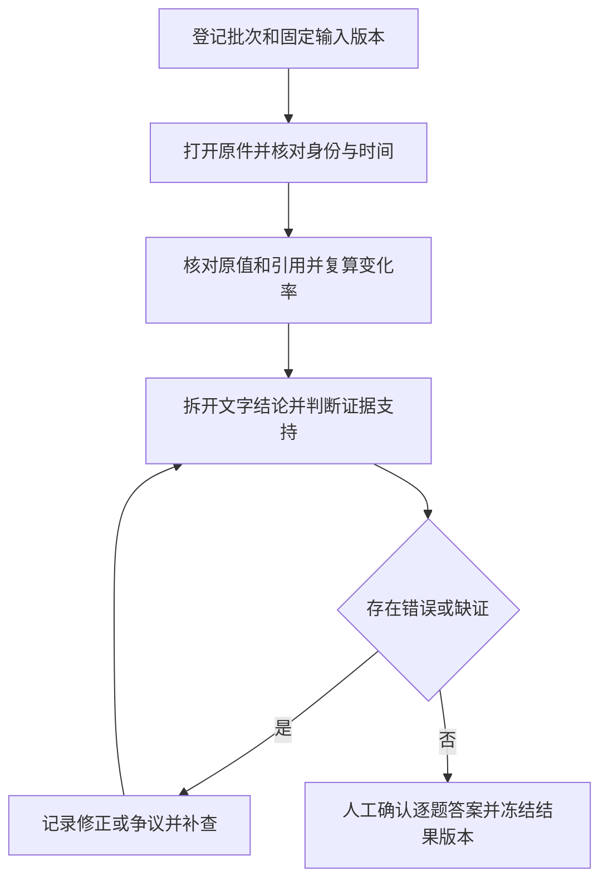

# 财报研究人工标注手册

这份手册说明需要审核哪些数据、如何对照年报标注，以及什么结果才可以作为人工参考答案。实际填写从 [开发集标注表](human-annotation-worksheet.md) 开始；资料和评分的权威来源仍是 [评测合同](evaluation.md) 与冻结 JSON。

本手册和仓库内的填写表用于开始新批次，不代表某个批次已经审核。冻结 v1 答案由 Agent 整理，原始 `humanReview: pending` 字段不随后续签字改写；已确认批次的当前状态见 [评测合同](evaluation.md) 与 [交接记录](progress.md)。你本人可以对照原件担任人工复核者；模型之间交叉检查不能代替人的确认。

## 1. 要标哪些数据

第一轮覆盖四家公司：贵州茅台、五粮液、美的集团、万华化学，各有 2023 年和 2024 年年报。标注表已展开全部开发集候选数值、引用和风险答案，并提供逐题填写位置。

| 对象 | 数量 | 需要人工确认什么 |
| --- | --- | --- |
| 原始年报 | 8 份 | 公司、年度、文件版本、披露证据、截止时间及金额口径 |
| 原始数值 | 24 项 | 两期的营业收入、归母净利润、经营现金流净额；原值与规范化元值一起核对 |
| 变化率 | 12 项 | 每家公司上述三个指标从 2023 年到 2024 年的增幅 |
| 已登记引用 | 32 条 | 24 条数值引用、8 条风险引用的文件、页码、引文及上下文 |
| 研究问题 | 12 题 | 每家公司 q1、q2、q3 的回答覆盖度与逐条结论的证据支持 |
| 困难样本 | 9 项 | 核对既定预期行为；实际系统是否通过，需另看行为测试或运行证据 |

24 个原始数值加 12 个变化率，构成评分中的 **36 个必需数值项**。同一原值的元值换算不另增分母。32 条引用是现有核对起点，不是证据支持率的分母；解释和风险结论不够充分时，需要补充相同冻结原件中的证据。

两家保留集、四份年报、六道题由评测维护者在受控仓库外单独标注。普通开发标注不读取或复制保留题与答案；不能把其内容写到本表。

### 三道题的固定要求

| 题目 | 原题 | 人工答案至少包含 |
| --- | --- | --- |
| q1 | 比较两期营业收入与归母净利润及增幅，说明口径。 | 两期四个原值、两个增幅、年度/单位/币种/合并与累计口径、原文依据 |
| q2 | 比较两期经营活动现金流量净额及增幅，与利润方向是否一致？解释须有证据。 | 两期现金流原值、一个增幅、与利润方向比较；有原文支撑的解释或明确未解决的解释缺口 |
| q3 | 比较主要风险的延续与表述变化，引用两期原文；不要把未发现写成风险消失。 | 两期风险原文、延续与变化的逐项判断；证据能支持的边界 |

2026-10-25 用户已确认现金流题接受有证据、可复算的会计分解，具体范围见 [U02 评分确认](rubric-v2-confirmation-20261025.md)。两年调节表可以支持会计贡献解释；答案应明确合并/归母、期间和单位，不把会计项目变化直接推定为需求或回款原因。同年现金流与利润差额的说明，须有额外两年证据才能解释同比变化。规则确认与每题原件、参考答案及模型响应审核分别登记。

原 v1 工作表的数值与引文及九完整/三 partial 状态保持原样。2026-10-25 用户通过 [Q1A—Q3A 回执](block1-confirmation-20261025.md) 另行确认三道现金流题的数值、方向及两年调节表会计解释范围，旧四家 12 题可回答性因此冻结；不追认旧模型缺答，也不扩展为新 14 家样本的人审。新题风险只有标题或截断片段时，仍须阅读全文后才能确认解释。

2026-10-26用户回复 `A A  A B`，选择 [Q6A/Q7A/Q8A/Q9B](acceptance-confirmation-20261026.md)。新增10家的数值与比较口径、10题现金流可回答性及限定风险参考已按“AI核对原件、用户接受展示范围”单独确认；平安/招行风险整题覆盖仍partial，光明不再是未披露候选。新 [参考覆盖层](../../../fixtures/company-research/confirmed-references-20261026.json) 保存修正金额和解释，不覆盖原v2草稿；尚未接入正式评分或晋升整家公司golden。扫描、全量标签、U05页金标与报告响应各自继续核对。

## 2. 从哪里拿资料

| 输入 | 作用 |
| --- | --- |
| [development.json](../../../fixtures/company-research/development.json) | 冻结开发题、候选答案、原始数值与引用 |
| [documents.json](../../../fixtures/company-research/documents.json) | 官方原文 URL、本地路径、报告期、披露证据和文件 SHA-256 |
| [rubric.json](../../../fixtures/company-research/rubric.json) | 已冻结的评分分母、容差、门槛及硬门 |
| [adversarial.json](../../../fixtures/company-research/adversarial.json) | 九个困难样本及预期行为 |
| [开发集标注表](human-annotation-worksheet.md) | 本轮具体数据、32 条引文、待填写结果与签字位置 |

在项目根目录工作。本地原件位于 `data/research-agent-upgrade/dataset-v1/development/<证券代码>/<年份>.pdf`，不随 Git 提交。文件缺失时，按 [评测合同的恢复步骤](evaluation.md#复验与恢复) 恢复固定版本；不要下载最新年报替代。原件打不开、hash 不匹配或对应页缺失时，先登记阻塞。

标注表列出各原件的官方链接与完整 hash。可用下面的 PowerShell 命令核对一个文件，再对照标注表中的预期值：

```powershell
Get-FileHash -Algorithm SHA256 -LiteralPath data/research-agent-upgrade/dataset-v1/development/600309/2024.pdf
```

PDF 页码从文件第一页开始计数。美的 2024 年财务表在文件第 9 页、印刷第 8 页，不能把两种页码混写。固定研究截止时间为 `2025-06-30T15:59:59.999Z`，即北京时间 2025-06-30 23:59:59.999；只有日期的披露证据按披露日结束后可用处理，不虚构具体发布时分秒。

## 3. 按什么顺序做



1. **登记批次。**复制标注表到 `data/research-agent-upgrade/annotations/<批次名>/review.md`，填写 batchId、审核人代号、开始时间和输入 hash。这是建议的结果目录，并无自动导入功能。保留仓库模板为待填写版本，便于重新开始独立标注。实际签字和原始记录归评测维护者保管，至少保留至 S20 及稳定归档。
2. **先读原文，再看草稿。**先自行找到财务表和风险章节，再对照候选答案。逐份确认公司/年度、合并或母公司、全年累计、人民币单位和重述情况。官方披露日期及其证据见清单，不能拿抓取时间替代。
3. **核对六个原值及引用。**每家公司按 F01—F06 确认原值、单位和元值，按 C01—C06 检查引文是否真在指定页。表格需连同列头、单位和脚注一起看。美的原值为千元，换算为元只乘一次 1000。引用文字存在，与引用能证明结论，分别填写。
4. **复算三个变化率。**用同口径数值复算 D01—D03，保留计算式和未四舍五入结果，再填写展示值。若有重述，记录原披露与重述版本、列名及影响；未统一口径前不得直接算同比。基期为零、缺值或期间不可比时记录原因，不填 0%。
5. **逐条标文字结论。**阅读 C07—C08 的完整风险段落，必要时新增引用。从 q1—q3 中拆出每个有实质含义的结论，填写 A 项的语义标签与依据。现金流原因、风险程度变化分别判断，不能只确认一句中的一半。缺证就保留缺口，矛盾就保留双方来源并登记争议。
6. **写人工答案并确认。**每题写出修正后的完整答案、引用和未解决项，再签审核人代号与实际时间。有争议的口径或因果判断建议由第二个人独立复核；记录两人的判断及最终理由。未解决的争议不能签成通过。

用户已在会话中明确表示亲自对照原文复核并确认时，可以将该原话、匿名审核人代号、确认记录时间和对应稿件 hash 保存为确认依据，无需重复要求同一次确认。记录时间与用户实际完成复核的时间分别说明；不猜测未提供的时间，不代填手写式签名。技术复算和引文规范化另留记录，不能把缺证项目一并改成通过。

可先完成万华化学熟悉流程，再处理美的的千元换算，最后完成其余两家。顺序不改变评分样本或分母。每完成一家就保存批次文件，下一次从未完成的 F/C/D/A 项继续。

## 4. 标签怎样填写

以下标签用于本次 Markdown 人工记录，尚未接入程序 schema。引用、数值、语义和整题分开记录，避免一个“通过”掩盖多种问题。

| 对象 | 标签 | 何时使用 |
| --- | --- | --- |
| 数值 F / 变化率 D | `pending` | 尚未人工核对 |
| 数值 F / 变化率 D | `approved` | 原值、口径、换算或计算已核对正确 |
| 数值 F / 变化率 D | `corrected` | 原候选有错；已填更正值、原文和理由，旧值仍保留 |
| 数值 F / 变化率 D | `needs_evidence` / `not_comparable` / `disputed` | 缺来源、不可比较或尚有争议；不得视为通过 |
| 引用 C | `pending` / `matched` / `mismatched` / `unreadable` | 未核对／版本页码引文匹配／不匹配／无法辨认 |
| 语义 A | `pending` / `supported` / `contradicted` / `insufficient_evidence` / `disputed` | 未核对／充分支持／证据相反／证据不足／有争议 |
| 整题 q | `pending` / `approved` / `partial` / `blocked` | 未核对／必需答案和证据齐全／已有部分答案但缺必需内容／关键资料或争议阻塞 |

`matched` 只表示引文定位正确。真实引文也可能被用于支持相反结论。`corrected` 需要在修正记录中写出最终值及依据；涉及争议的修正，先保持 `disputed`，完成裁定后再更新。

### 数值如何判断

```text
变化率（%）=（2024 年同口径值 − 2023 年同口径值）÷ |2023 年同口径值| × 100
```

使用计算器或明确精度的计算工具，不能靠模型心算代替。冻结容差为：原始金额取原表最小显示单位的一半，元值容差再乘单位倍率；百分比允许差为 0.01 个百分点。例如原表精确到 0.01 元，金额容差为 0.005 元；精确到 1 千元，元值容差为 500 元。原文抄录仍应保留其实际显示值和精度，不能主动用容差掩盖错抄。

每家公司九个必需数值都需标注，漏答不会从分母移除。归母净利润不能替换成总净利润、扣非净利润；经营现金流净额不能替换成每股现金流、自由现金流或现金余额。

### 文字结论如何判断

将“数值变化”“原因解释”“风险分类”“风险程度”拆开。管理层的原因说明应写成“年报将该变化归因于……”，避免把披露者的解释升级为独立验证的唯一因果。推断要标为推断，并检查其证据链。

| 待判断内容 | 示例判定方法 |
| --- | --- |
| 万华经营现金流增长、归母净利润下降 | 原值和复算通过后，方向比较可以标 `supported` |
| 万华现金流增长是因为回款改善 | 单凭指标表不能支持，应为 `insufficient_evidence`；找到原文后再判断 |
| 万华风险标题从组织绩效变为激励体系 | 两期指定段落核对后可以判断表述变化；“安全和人才风险延续”还需另外核对完整风险章节 |
| 美的贸易壁垒风险首次出现于 2024 年 | 2023 年已有相关风险标题，不能批准“首次出现”的表述 |
| 两年风险标题相同，所以风险程度没有变化 | 标题相同不足以证明程度不变 |

这些是教学示例，不是已经完成的人工作业。若答案有一句“收入增长、利润下降，因此竞争力恶化”，至少拆成收入、利润、竞争力判断三项，分别确认依据。每个复合风险结论同样要拆开，不用一个标签覆盖整段。

## 5. 最终结果应该是什么样

最终交付是一份**可追溯的已填写审核记录**。它至少包含批次身份、固定输入版本、八份文档检查、36 个数值判断、32 条引用判断、逐结论标签、12 题人工答案、更正/争议记录及真人签字。新增引用按原件版本、PDF 文件页和原文登记；无坐标时不填写推测坐标。

一条完整审核记录建议采用下面格式。尖括号是待填写内容，不能原样作为审核结果：

```yaml
batchId: <本轮批次名>
caseId: dev-600309
questionId: q2
itemId: dev-600309/F06
candidate: 30053435178.33 元
source:
  documentId: 600309-2024-annual
  bytesSha256: 0c37e70c554609f4a22990fd97f3da4ee92bb717e44d641ac7800083789d4df7
  filePage: 7
  quote: <人工核对的原文，保留表头和单位>
verdict: <approved / corrected / needs_evidence / not_comparable / disputed>
finalValue: <实际核对后的值及单位>
reason: <为什么通过或如何修正>
reviewerId: <实际审核人代号>
reviewedAt: <实际时间，含 +08:00 时区>
```

每题的最终人工答案应能独立阅读，不只写“同意 Agent”。例如 q2 应写两期金额、增幅、利润方向比较，再写有证据的解释及出处；解释没找到就写明查过哪些范围、缺什么证据，整题保留 `partial`，不自动算完成。

### 一个批次的收尾清单

- [ ] 批次登记输入 JSON 的版本/hash、开始与完成时间、实际审核人代号。
- [ ] 八份原件的身份、hash、披露证据、期间和口径已核对，疑问已处理。
- [ ] 36 个数值项都有标签；所有修正有最终值、依据和确认记录。
- [ ] 32 条现有引用都有核对结果；补充引用已登记同样的来源信息。
- [ ] q1—q3 的实质结论逐条判断，12 题都有人工答案或明确的 partial/blocked 原因。
- [ ] 没有未解决争议被记成通过；最终可用答案及其证据已确认。
- [ ] 困难样本的预期与实际执行结果分别记录；未执行不填 pass。
- [ ] 保存已填写 Markdown 和 SHA-256，实际目录及审核摘要登记到 progress.md。

只有三题都通过且相关原值、计算、语义和文档前提均已核对的一家公司，才可登记为已完成的人工参考公司。可以先完成部分公司，但要报告实际数量，未核查的其余公司保持待审；不能因审核某一条数字就把整家公司晋为 golden。

人工答案的完备性与模型的验收成绩分别报告。模型质量仍按冻结 rubric：开发数值分母 36、题目分母 12、证据支持分母为模型报告中的全部实质结论；缺答计错，partial/failed/cancelled/unsupported 不算完成，所有硬门需通过。95% / 90% / 80% 是模型目标，不是允许人工参考答案留下已知错误的比例。

## 6. 如何保存并让后续会话使用

保留原有冻结 JSON。人工发现错误时，在批次文件中追加 itemId、旧值、新值、原文、原因和审核记录；需要修正正式参考集时另建有版本的人工参考产物，并登记其 hash、与 v1 的差异及受影响的可比基线。不能为了候选模型得分而静默改题、改答案或放宽评分。

目前没有从 Markdown 自动生成 golden JSON 的导入器。[现有验证器](../../../scripts/research/verify-fixtures.ts) 只检查原件、引文存在性、单位和计算等，并固定输出人工未审核状态；它不会读取本表的签字，也不会验证语义。下面命令可以做机器预检，不能作为人工签字或模型质量通过证据：

```powershell
node --import tsx scripts/research/verify-fixtures.ts
npm run check:docs
```

第一次人工确认后，维护者需在 [progress.md](progress.md) 登记：已审核公司/题目/项目数量、结果文件位置/hash、审核版本、仍待解决的问题。将人工结果接入评分器时需单独实现版本读取与验证，不能预先声称现有 runner 已使用人工结果。普通仓库交接只保存脱敏摘要，不提交签字者的个人资料或私有题。

后续会话接续人工标注时可以使用：

```text
继续财报研究人工标注。先读 human-annotation.md 与 progress.md，
核对当前批次 review.md、冻结输入版本和未完成项目。
保留已有人工记录；协助定位原文、整理修正和检查覆盖，
不代填真人签字，不把机器检查当成人工审核。
```

本标注任务不自动启动 S06 或修改研究执行器。开发状态、实际人工审核进度、fixture 验证和真实模型质量验收继续分别记录。
